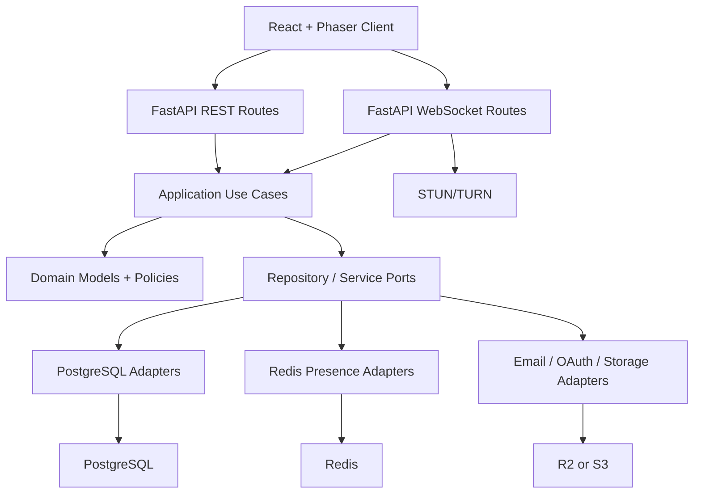

# HackVerse Backend Implementation Plan

## 1. Decision

HackVerse will use **FastAPI** for the MVP backend.

Primary reason: the product's core backend risk is real-time campus behavior: presence, movement, WebSockets, room state, mentor requests, announcements, and WebRTC signaling. FastAPI gives us an async-first backend with less framework weight than Django while still supporting clean REST APIs, typed schemas, WebSockets, and testable service boundaries.

## 2. Backend Goals

- Support a desktop-first 2D hackathon campus with hundreds of concurrent users.
- Keep the first backend simple enough for a small team to ship.
- Separate durable data from real-time ephemeral state.
- Make core business logic testable without a running database.
- Avoid premature microservices, while leaving clear seams for later extraction.
- Prioritize live-event reliability over broad feature count.

## 3. Initial Architecture

Use a modular monolith with clean architecture boundaries.



Dependency rule:

- `domain` imports nothing from FastAPI, SQLAlchemy, Redis, or Pydantic.
- `application` imports `domain` and abstract ports only.
- `infrastructure` implements ports using PostgreSQL, Redis, storage, auth providers, and email.
- `api` translates HTTP/WebSocket payloads into application commands.

## 4. Recommended Stack

| Concern | Choice | Why |
|---|---|---|
| API framework | FastAPI | Async-first, typed, WebSocket-capable |
| Runtime | Python 3.12 | Current stable Python with good typing and async support |
| ASGI server | Uvicorn | Standard FastAPI runtime |
| Database | PostgreSQL | Relational source of truth for events, teams, rooms, users |
| ORM | SQLAlchemy 2.0 async | Mature, explicit, flexible |
| Migrations | Alembic | Standard SQLAlchemy migration tooling |
| Validation | Pydantic v2 | FastAPI-native request/response models |
| Cache/presence | Redis | Presence TTLs, room state, pub/sub, rate limiting |
| Auth | Session/JWT hybrid | Browser-friendly sessions, signed access for WebSockets |
| Tests | Pytest + pytest-asyncio | Async backend testing |
| Lint/format | Ruff | Fast formatting and linting |
| Type checks | Pyright or mypy | Catch interface drift |
| Config | pydantic-settings | Typed environment config |
| Containers | Docker Compose | Local Postgres + Redis + backend |

## 5. Repository Layout

Recommended backend structure:

```text
backend/
  app/
    main.py
    api/
      deps.py
      errors.py
      router.py
      http/
        auth_routes.py
        event_routes.py
        team_routes.py
        room_routes.py
        mentor_routes.py
        sponsor_routes.py
        announcement_routes.py
        analytics_routes.py
      ws/
        connection_manager.py
        event_socket.py
        schemas.py
    application/
      auth/
      events/
      teams/
      rooms/
      mentors/
      sponsors/
      announcements/
      analytics/
      realtime/
    domain/
      common/
      identity/
      events/
      teams/
      rooms/
      mentors/
      sponsors/
      announcements/
      realtime/
    infrastructure/
      config.py
      db/
        base.py
        session.py
        models/
        repositories/
      redis/
        client.py
        presence_store.py
        pubsub.py
      auth/
        tokens.py
        google_oauth.py
        invite_tokens.py
      storage/
        object_store.py
      observability/
        logging.py
        metrics.py
    workers/
      cleanup.py
  migrations/
  tests/
    unit/
    integration/
    e2e/
  alembic.ini
  pyproject.toml
  Dockerfile
```

This is intentionally one backend app, not microservices. We split by module and architecture layer, not deployment unit.

## 6. Backend Modules

### Identity/Auth

Responsibilities:
- Google login as the only account creation/sign-in method.
- Event invite token claiming after Google authentication.
- Invite email matching and domain checks where configured.
- Session creation.
- WebSocket authentication.

MVP entities:
- User.
- EventMember.
- InviteToken value object.

### Events

Responsibilities:
- Event creation/configuration.
- Event status: draft, live, ended, archived.
- External event links.
- Map selection.

MVP entities:
- Event.
- Map.

### Teams

Responsibilities:
- Team import.
- Team membership.
- Team room linking.

MVP entities:
- Team.
- TeamMember.

### Rooms

Responsibilities:
- Room definitions.
- Room access policy.
- Room enter/leave authorization.
- Room-scoped chat permissions.

MVP entities:
- Room.
- RoomAccessPolicy.

### Realtime

Responsibilities:
- WebSocket lifecycle.
- Player join/move/leave.
- Presence state.
- Nearby calculations.
- Redis pub/sub fanout.
- WebRTC signaling authorization.

MVP concepts:
- Connection.
- PresenceSnapshot.
- PlayerPosition.
- RealtimeRoomState.

### Mentors

Responsibilities:
- Mentor profile.
- Availability.
- Mentor request lifecycle.
- Temporary mentor access to team rooms.

MVP entities:
- MentorProfile.
- MentorRequest.

### Sponsors

Responsibilities:
- Sponsor profile.
- Sponsor booth.
- Resource links.
- Booth visit/click tracking.

MVP entities:
- Sponsor.
- SponsorBooth.

### Announcements

Responsibilities:
- Organizer-created announcements.
- Targeting: all, role, room, team.
- WebSocket delivery.
- Stored history.

MVP entities:
- Announcement.

### Analytics

Responsibilities:
- Append interaction events.
- Produce organizer summaries.
- Produce technical health summaries.

MVP entities:
- InteractionEvent.

## 7. Data Persistence Rules

Use PostgreSQL for durable state:
- Users.
- Events.
- Event members.
- Teams.
- Rooms.
- Sponsors.
- Announcements.
- Mentor requests.
- Interaction events.
- Maps and configured zones.

Use Redis for ephemeral real-time state:
- Online users.
- Socket connection IDs.
- Current positions.
- Current room/zone.
- Nearby user cache.
- Per-event pub/sub channels.
- Short-lived WebRTC signaling sessions.
- Rate limiting counters.

Do not store raw audio/video. Do not store live coordinates permanently except as aggregate analytics.

## 7A. Google-Only Invite Authentication Flow

HackVerse must not support raw email/password accounts or standalone email magic-link accounts. All real user accounts are created and authenticated through Google.

Invite links are not authentication. They are event authorization context.

Flow:

1. Organizer creates an invite for a participant, mentor, sponsor, or admin.
2. Backend stores only a hash of the invite token.
3. User opens `/auth/invite/{invite_token}`.
4. Backend validates that the invite exists, is unexpired, and is not revoked.
5. If the user is not authenticated, backend stores the invite token in OAuth `state` or a short-lived server-side pending-auth record and redirects to Google.
6. User completes Google sign-in.
7. Backend verifies Google ID token claims, especially issuer, audience, expiry, email, and `email_verified`.
8. If no HackVerse user exists for the verified Google subject/email, backend creates one.
9. Backend claims the invite for that Google-authenticated user.
10. Backend creates or activates the `event_members` record with the invited role/team context.
11. User is redirected to event onboarding/profile/avatar selection.

Important implementation rules:
- Do not create a HackVerse account before Google identity is verified.
- Do not let a user claim an invite with manually typed email alone.
- If an invite was created for a specific email, enforce exact match against the verified Google email unless the event explicitly allows open domain invites.
- Store Google provider subject (`sub`) so email changes do not break identity.
- Keep a unique constraint on Google provider identity and normalized email.
- Local development may use a test-auth override only when `APP_ENV=local` or `test`.

## 8. MVP Database Sequence

Build migrations in this order:

1. `users`
2. `events`
3. `event_members`
4. `maps`
5. `rooms`
6. `teams`
7. `team_members`
8. `mentor_profiles`
9. `mentor_requests`
10. `sponsors`
11. `sponsor_booths`
12. `announcements`
13. `interaction_events`

Important constraints:
- `event_members` must be unique by `(event_id, user_id)`.
- `teams` must be unique by `(event_id, name)`.
- Room access must always be checked by `event_id`.
- Never rely on client-provided role or event membership.

## 9. API Implementation Phases

### Phase 1: Project Foundation

Deliverables:
- FastAPI project scaffold.
- Health endpoint.
- Config management.
- SQLAlchemy async session.
- Alembic.
- Docker Compose for Postgres and Redis.
- Pytest setup.

Acceptance criteria:
- `GET /health` returns app, DB, and Redis status.
- Tests run locally with one command.
- Migrations can create the empty schema.

### Phase 2: Auth + Event Membership

Deliverables:
- User model.
- Event model.
- EventMember model.
- Google OAuth login.
- Invite token resolution before login.
- Invite token claim flow after Google authentication.
- Local-only test auth override for automated tests, disabled outside development.
- WebSocket token/session validation.

Acceptance criteria:
- User opening an invite link is redirected to Google sign-in if unauthenticated.
- If the Google account does not exist in HackVerse, a user account is created from the verified Google identity.
- After Google authentication, the invite token is claimed and the user is attached to the event role/team encoded by the invite.
- User receives a session/access token.
- Backend can identify role and event membership.

### Phase 3: Event Setup APIs

Deliverables:
- Event CRUD.
- Map selection.
- External links.
- Participant/team import stubs.
- Admin authorization.

Acceptance criteria:
- Admin can create a draft event.
- Admin can publish event.
- Participant can fetch event config.

### Phase 4: Rooms + Teams

Deliverables:
- Room CRUD.
- Team CRUD/import.
- Team membership.
- Team room assignment.
- Room authorization use case.

Acceptance criteria:
- Team member can enter team room.
- Non-member is denied.
- Admin can enter any room.

### Phase 5: WebSocket Presence

Deliverables:
- Event WebSocket endpoint.
- Connection manager.
- Redis presence store.
- `player:join`, `player:move`, `player:leave`.
- Nearby broadcast.
- Reconnect handling.

Acceptance criteria:
- Multiple clients can see each other's positions.
- Disconnected users disappear after TTL.
- Invalid movement messages are rejected/rate-limited.

### Phase 6: Chat + Announcements

Deliverables:
- Room chat WebSocket events.
- Announcement REST API.
- Announcement WebSocket delivery.
- Basic chat persistence decision implemented.

Acceptance criteria:
- User can send room chat only to authorized room.
- Admin announcement reaches active clients.

### Phase 7: Mentor Flow

Deliverables:
- Mentor profile/status APIs.
- Mentor request lifecycle.
- WebSocket notifications.
- Temporary room access for accepted mentors.

Acceptance criteria:
- Participant can request help.
- Mentor can accept and complete request.
- Mentor can enter team's room only after authorization.

### Phase 8: Sponsor Booths + Analytics

Deliverables:
- Sponsor CRUD.
- Booth resources.
- Booth visit/click tracking.
- Analytics summary endpoint.

Acceptance criteria:
- Organizer can configure sponsor booth.
- Visits/clicks appear in analytics.

### Phase 9: WebRTC Signaling

Deliverables:
- `rtc:offer`, `rtc:answer`, `rtc:ice`.
- Proximity/session authorization.
- Session cleanup.
- TURN config endpoint.

Acceptance criteria:
- Signaling is only forwarded between authorized participants.
- Moving away or leaving room invalidates proximity session.

### Phase 10: Reliability + Load

Deliverables:
- Structured logs.
- Metrics hooks.
- Error handling.
- Rate limits.
- Load-test script for WebSocket movement.
- Deployment checklist.

Acceptance criteria:
- 100 simulated WebSocket users can connect and move.
- Server recovers from short Redis/API interruptions gracefully.

## 10. REST API Surface

Initial route groups:

```text
GET    /health

POST   /auth/google
GET    /auth/google/start
GET    /auth/google/callback
GET    /auth/invite/{invite_token}
POST   /auth/invite/claim
POST   /auth/logout

POST   /events
GET    /events/{event_id}
PATCH  /events/{event_id}
POST   /events/{event_id}/publish
GET    /events/{event_id}/config

POST   /events/{event_id}/members/import
GET    /events/{event_id}/members
PATCH  /events/{event_id}/members/{member_id}

POST   /events/{event_id}/teams/import
GET    /events/{event_id}/teams
GET    /events/{event_id}/teams/me
PATCH  /events/{event_id}/teams/{team_id}

GET    /events/{event_id}/rooms
POST   /events/{event_id}/rooms
PATCH  /events/{event_id}/rooms/{room_id}
POST   /events/{event_id}/rooms/{room_id}/authorize

GET    /events/{event_id}/mentors
PATCH  /events/{event_id}/mentor-profile
POST   /events/{event_id}/mentor-requests
GET    /events/{event_id}/mentor-requests
POST   /events/{event_id}/mentor-requests/{request_id}/accept
POST   /events/{event_id}/mentor-requests/{request_id}/complete

GET    /events/{event_id}/sponsors
POST   /events/{event_id}/sponsors
PATCH  /events/{event_id}/sponsors/{sponsor_id}
POST   /events/{event_id}/sponsor-booths/{booth_id}/visit
POST   /events/{event_id}/sponsor-booths/{booth_id}/click

GET    /events/{event_id}/announcements
POST   /events/{event_id}/announcements

GET    /events/{event_id}/analytics/summary
GET    /events/{event_id}/analytics/health
```

## 11. WebSocket Contract

Endpoint:

```text
GET /ws/events/{event_id}
```

Authentication:
- Browser session cookie or short-lived WebSocket token.
- Server validates event membership before accepting gameplay events.

Client events:

```text
player:join
player:move
player:status
room:enter
room:leave
chat:message
mentor:request
mentor:accept
rtc:offer
rtc:answer
rtc:ice
moderation:report
```

Server events:

```text
player:joined
player:left
player:update
nearby:update
room:entered
room:denied
chat:message
mentor:request:new
mentor:request:accepted
announcement:new
rtc:offer
rtc:answer
rtc:ice
moderation:action
system:error
```

Message envelope:

```json
{
  "type": "player:move",
  "requestId": "client-generated-id",
  "sentAt": "2026-10-07T05:30:00Z",
  "payload": {}
}
```

Server error envelope:

```json
{
  "type": "system:error",
  "requestId": "client-generated-id",
  "payload": {
    "code": "ROOM_ACCESS_DENIED",
    "message": "You cannot enter this room."
  }
}
```

## 12. Domain Policies

Core policies to implement as framework-free domain/application code:

- `CanJoinEventPolicy`
- `CanEnterRoomPolicy`
- `CanSendRoomChatPolicy`
- `CanModerateMemberPolicy`
- `CanRequestMentorPolicy`
- `CanAcceptMentorRequestPolicy`
- `CanStartMediaSessionPolicy`
- `CanViewSponsorAnalyticsPolicy`

These policies should be unit-tested with in-memory repositories.

## 13. Testing Strategy

### Unit Tests

Use in-memory repositories for:
- Event membership checks.
- Room access policies.
- Mentor request lifecycle.
- Announcement targeting.
- Sponsor analytics event creation.

### Integration Tests

Use test Postgres/Redis for:
- Migrations.
- Repository implementations.
- REST route authorization.
- Redis presence TTL.
- WebSocket connect/auth.

### End-to-End Backend Tests

Scenarios:
- User opens invite, signs in with Google, claims invite, joins event WebSocket, moves, and leaves.
- Team member enters team room; non-member denied.
- Organizer sends announcement; connected user receives it.
- Participant requests mentor; mentor accepts; participant receives notification.
- WebRTC signaling between unauthorized users is rejected.

## 14. Local Development Flow

Target commands:

```text
make dev
make test
make lint
make format
make migrate
make revision name="create users"
```

Initial local services:
- Backend on `http://localhost:8000`.
- PostgreSQL on `localhost:5432`.
- Redis on `localhost:6379`.
- OpenAPI docs on `http://localhost:8000/docs`.

## 15. Deployment Shape

MVP deployment:
- One API/WebSocket container initially.
- Managed PostgreSQL.
- Managed Redis.
- Object storage for map/assets.
- CDN for static assets.
- TURN server separate from app backend.

Near-term scale:
- Split API and WebSocket processes only when needed.
- Add multiple WebSocket replicas with Redis pub/sub.
- Partition presence updates by event and room/area.

Do not start with Kubernetes unless the team already has operational comfort with it. A simpler container platform is enough for pilots.

## 16. Observability

Minimum logs:
- Request ID.
- Event ID.
- User/member ID when available.
- WebSocket connect/disconnect.
- Room enter/deny.
- Mentor request lifecycle.
- Announcement delivery.
- RTC signaling failures.
- Moderation actions.

Minimum metrics:
- Active WebSocket connections per event.
- Movement messages per second.
- Redis latency.
- DB latency.
- WebSocket disconnect rate.
- WebRTC signaling failure count.
- API error rate.

## 17. Security Requirements

- Validate auth on every REST and WebSocket action.
- Enforce event isolation in repositories and policies.
- Rate-limit Google auth callbacks, invite claim, chat, movement, and signaling.
- Sanitize chat and rich text fields.
- Store invite tokens as hashes.
- Never expose raw participant emails to sponsors.
- Store secrets only in environment/secret manager.
- Log moderation actions.

## 18. First Implementation Sprint

Sprint goal: create a working FastAPI backend foundation.

Deliverables:
1. `backend/` project scaffold.
2. `pyproject.toml` with FastAPI, SQLAlchemy, Alembic, Redis, pytest, Ruff.
3. `docker-compose.yml` for PostgreSQL and Redis.
4. `GET /health`.
5. Async DB connection.
6. Redis connection.
7. Alembic initialized.
8. Initial models for `users`, `events`, `event_members`.
9. Google auth flow scaffold plus invite claim stub.
10. Test suite with health and database smoke tests.

Definition of done:
- Backend starts locally.
- `/health` verifies app, DB, and Redis.
- Migrations run cleanly.
- Tests pass.
- Repo contains clear setup instructions.

## 19. Clarifying Questions

These answers will affect implementation decisions:

1. Do you want the backend to be a separate `backend/` folder now, with frontend added later as `frontend/`, or do you prefer a single app structure from day one?
2. Should Google OAuth be configured with your existing Google Cloud project, or should we scaffold placeholders and wire credentials later?
3. For the first prototype, should events be invite-only, or can anyone with the event link join?
4. Should we build with SQLAlchemy 2.0 directly, or do you prefer SQLModel for a more Pydantic-like model style?
5. Do you want Docker Compose for local PostgreSQL/Redis immediately?
6. Which deployment target do you expect for pilots: Render, Railway, Fly.io, AWS, DigitalOcean, or something else?
7. Should chat messages be stored in PostgreSQL for MVP moderation, or should early chat be ephemeral?
8. For audio/video, should MVP backend only implement WebRTC signaling first, leaving media UX to frontend later?
9. Should organizer/admin APIs be built before participant gameplay APIs, or should we prioritize gameplay foundation first?
10. Do you want me to start implementing Sprint 1 next?

## 20. Recommended Answers

If you want the fastest practical path, my recommended defaults are:

1. Use `backend/` now and add `frontend/` later.
2. Start with Google-only account creation/sign-in; allow only a local test-auth override for automated tests and development.
3. Make pilot events invite-only.
4. Use SQLAlchemy 2.0 directly.
5. Add Docker Compose immediately.
6. Keep deployment provider-neutral for now.
7. Store room chat for 30 days, but make retention configurable.
8. Implement WebRTC signaling contract, not media handling, in backend.
9. Build gameplay foundation first, then organizer dashboard APIs.
10. Start Sprint 1 now.
