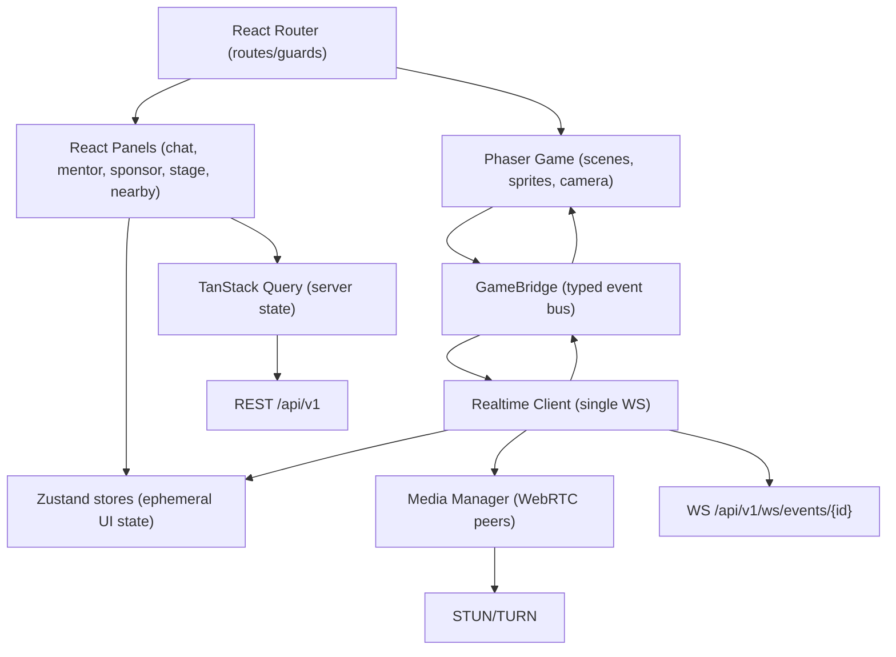

# HackVerse Frontend Implementation Plan

This document is the frontend counterpart to `backend-implementation-plan.md`. It assumes the backend decisions already made (FastAPI, cookie session auth, `/api/v1` prefix, WebSocket at `/api/v1/ws/events/{event_id}`) and plans the client that consumes them.

## 1. Decision

HackVerse will use **React + TypeScript + Vite + Phaser 3 + Tailwind CSS** for the MVP frontend, built as a **single SPA containing three surfaces**: participant campus, mentor/sponsor panels, and the organizer dashboard.

Primary reason: the product's core frontend risk is a game loop and a UI tree fighting over the same browser. Phaser owns rendering and movement at 60fps; React owns panels, forms, chat, and notifications. They must never re-render each other. Everything else in this plan follows from that separation.

Secondary reasons:
- Vite keeps dev iteration fast and makes it trivial to lazy-load the Phaser chunk so the organizer dashboard never pays for the game engine.
- One SPA (not two apps) means one auth session, one API client, one WebSocket client, and one deploy artifact — matching the "modular monolith" posture of the backend.

## 2. Frontend Goals

- Participant goes from invite link to spawned avatar in under 60 seconds.
- Hold a smooth frame rate with 100+ visible avatars on an average student laptop.
- Never start audio or video without an explicit user action.
- Degrade gracefully: video → audio → chat → static event links.
- Keep bandwidth low by default; low-bandwidth mode is a first-class feature, not a toggle added late.
- Make the campus feel game-first and the dashboard feel dense and conventional.
- Keep client/server event contracts typed in one place so WebSocket drift is a compile error.

## 3. Architecture

Two runtimes in one page, joined by a typed bridge.



Ownership rules (the important part):

- **Phaser owns** the local player position, remote avatar sprites, interpolation, collision, camera, and tile rendering.
- **React owns** everything with text in it: panels, modals, chat, lists, forms, dashboard.
- **The realtime client owns** the single WebSocket. Nothing else opens a socket.
- **Remote player positions never enter React state.** They go `WS → GameBridge → Phaser`. A `player:update` at 15Hz × 100 users must cause zero React renders.
- **Derived, low-frequency facts may enter React state**: nearby member list (debounced ~250ms), current room, presence counts, connection status.
- **Phaser never calls `fetch`.** It emits intents (`zone:entered`, `interact:pressed`) on the bridge; React decides what to open.

Dependency rule, mirroring the backend:

- `game/` imports from `realtime/types` and `game/` only. No React, no TanStack Query, no components.
- `features/` (React) may import `api/`, `realtime/`, `stores/`, `ui/`.
- `api/` and `realtime/` import types only — no components, no stores other than via injected callbacks.
- `ui/` is presentational primitives with no feature knowledge.

## 4. Recommended Stack

| Concern | Choice | Why |
|---|---|---|
| Framework | React 19 + TypeScript | Mature panel/form/notification model, typed contracts |
| Build tool | Vite | Fast HMR, easy code splitting for the Phaser chunk |
| Game engine | Phaser 3 (Arcade physics) | Proven tilemap + collision + camera + sprite pooling |
| Map authoring | Tiled → JSON | Backend already stores and serves map JSON |
| Styling | Tailwind CSS | Fast consistent UI without a design system build-out |
| Routing | React Router (data router) | Nested layouts, route-level guards and loaders |
| Server state | TanStack Query | Caching, retry, background refetch, offline-ish behaviour |
| Client state | Zustand | Small, selector-based, no provider pyramid; easy to keep out of render path |
| Forms | React Hook Form + Zod | Shared Zod schemas validate both forms and WS payloads |
| WS contracts | Zod schemas + discriminated union | Runtime validation of every inbound message |
| Media | Browser WebRTC (no SFU in MVP) | Mesh is fine at a 4–6 peer cap |
| Icons | Lucide | Lightweight, consistent |
| Tests | Vitest + React Testing Library | Unit/component tests |
| E2E | Playwright | Join → move → chat → announcement flows, multi-tab |
| Lint/format | ESLint + Prettier | Standard |
| Errors/metrics | Sentry (or self-hosted alt) + custom perf beacon | PRD requires client error + FPS reporting |
| Container | Dockerfile (node build → nginx) | Parity with backend compose setup |

Deliberately **not** in the MVP stack: Next.js (no SSR need), Redux Toolkit (overkill), Socket.IO (backend uses raw WS), an SFU/mediasoup (post-MVP), a component library like MUI (fights the game-first aesthetic).

## 5. Repository Layout

```text
frontend/
  index.html
  vite.config.ts
  tailwind.config.ts
  tsconfig.json
  Dockerfile
  public/
    assets/            # fallback tilesets, avatar spritesheets
  src/
    main.tsx
    App.tsx
    app/
      router.tsx
      providers.tsx            # Query, Zustand hydration, error boundary
      guards.tsx               # RequireSession, RequireEventMember, RequireRole
      env.ts                   # typed import.meta.env access
    api/
      client.ts                # fetch wrapper, credentials:'include', error envelope
      errors.ts                # maps { error: { code, message } } to typed errors
      auth.ts
      events.ts
      members.ts
      teams.ts
      rooms.ts
      maps.ts
      announcements.ts
      mentors.ts
      sponsors.ts
      analytics.ts
      turn.ts
      queries.ts               # query keys + hooks
    realtime/
      types.ts                 # ClientMessage / ServerMessage discriminated unions
      schemas.ts               # Zod validation for inbound messages
      socket.ts                # connect, reconnect w/ backoff, heartbeat, send queue
      dispatcher.ts            # routes server messages to stores / bridge / media
      outbound.ts              # throttled senders (move at 12Hz, chat rate guard)
    game/
      GameRoot.tsx             # React wrapper: mounts/unmounts Phaser, no re-render
      bridge.ts                # typed event emitter between React and Phaser
      config.ts                # tile size, speeds, proximity radii, caps
      scenes/
        BootScene.ts
        CampusScene.ts
      objects/
        LocalPlayer.ts
        RemotePlayer.ts         # pooled sprites + label pooling
        ZoneOverlay.ts
      systems/
        MovementSystem.ts
        InterpolationSystem.ts
        ProximitySystem.ts
        InterestManager.ts      # cull/throttle far avatars
        ZoneSystem.ts
    features/
      auth/                    # invite landing, callback, logout
      onboarding/              # profile + avatar selection
      campus/                  # HUD, control bar, minimap, area directory
      nearby/
      chat/
      rooms/
      team/
      mentor/
      sponsor/
      stage/
      announcements/
      moderation/
      media/                   # device consent, mute/deafen, peer tiles
      organizer/
        events/
        members/
        teams/
        rooms/
        mentors/
        sponsors/
        announcements/
        analytics/
        moderation/
    media/
      MediaManager.ts           # peer lifecycle, caps, mute state
      PeerConnection.ts
      devices.ts
    stores/
      sessionStore.ts
      eventStore.ts
      presenceStore.ts          # counts + nearby only (never raw positions)
      roomStore.ts
      chatStore.ts
      notificationStore.ts
      mediaStore.ts
      settingsStore.ts          # low-bandwidth mode, volume, keybinds
    ui/                         # Button, Panel, Modal, Toast, Table, Badge...
    lib/
      throttle.ts
      backoff.ts
      perfBeacon.ts
      logger.ts
  tests/
    unit/
    component/
    e2e/
```

One app, split by layer and feature — not a monorepo, not micro-frontends.

## 6. Contract Alignment With the Current Backend

Verified against `backend/app` as it stands today. These are the facts the frontend must be built against, plus the gaps to close.

Confirmed:
- REST base path is `/api/v1`.
- Auth is a **session cookie** (`hackverse_session`), not a bearer token. All REST calls need `credentials: 'include'`.
- `GET /api/v1/auth/google/callback` redirects to `${FRONTEND_BASE_URL}/auth/callback?eventId=...`. The frontend must own that route.
- WebSocket authenticates from the same cookie (`websocket.cookies`), so **no token needs to be fetched before connecting** — but the socket URL must be same-site or cookies won't be sent.
- Existing WS client messages: `player:move`, `room:enter`, `room:leave`, `chat:message`, `player:interact`, `rtc:offer`, `rtc:answer`, `rtc:ice`.
- Existing WS server messages: `presence:snapshot`, `player:joined`, `player:update`, `system:error`, plus room/chat/rtc forwards.
- Backend serves uploaded map/logo assets from `/uploads`.
- There is a gamification layer not described in the PRD: `GET /events/{id}/leaderboard`, XP awarded via `player:interact`. The frontend should surface it behind a feature flag (see Phase 11) rather than pretend it doesn't exist.

Gaps to resolve with the backend (track these as cross-cutting tickets, not frontend phases):
1. **No CORS middleware is configured.** Either run the frontend behind a Vite dev proxy and a single origin in production, or add `CORSMiddleware` with `allow_credentials=True`. Recommendation: same-origin via proxy — it keeps the cookie `SameSite=Lax` story simple and avoids a WS cookie trap.
2. `player:leave` and `nearby:update` are in the PRD contract but not yet emitted by the server. Frontend will compute nearby **client-side** from presence data (Phase 5) and treat a server-side `nearby:update` as an optimization to adopt later.
3. RTC payloads currently use `targetUserId`; the PRD says `targetMemberId`. Pick one before Phase 9 and change both sides together.
4. `chat:message` is room-scoped only today; PRD also wants direct messages. Phase 6 ships room chat; DM is deferred until the server supports a `scope` field.
5. Mentor, sponsor, analytics, moderation, and CSV member-import endpoints are not all present yet. Phases 8 and 10 are gated on backend phases 7, 8, and the organizer APIs.

### Typed contract strategy

- Generate REST types from the backend OpenAPI schema (`openapi-typescript` against `http://localhost:8000/api/v1/openapi.json`) into `src/api/generated.ts`, regenerated by `make frontend-types`. Hand-written wrappers sit on top.
- Hand-write WebSocket types in `src/realtime/types.ts` as a discriminated union on `type`, with Zod schemas for inbound validation. Any unknown `type` is logged and dropped, never thrown.
- Treat the envelope as fixed: `{ type, requestId, sentAt, payload }` outbound; `{ type, requestId?, payload }` inbound.

## 7. State and Performance Rules

Performance budgets (enforced in Phase 11, measured from Phase 3):

| Budget | Target |
|---|---|
| Initial JS (dashboard route, gzip) | < 250 KB |
| Campus route total JS incl. Phaser (gzip) | < 900 KB |
| Time to interactive on mid laptop | < 3 s |
| Frame rate, 100 visible avatars | ≥ 45 fps sustained, 60 fps target |
| React renders caused by remote movement | 0 |
| Outbound move messages | ≤ 12/s normal, ≤ 5/s low-bandwidth |
| Nearby-list recompute | ≤ 4/s, debounced |

Techniques, applied from the first Phaser commit rather than retrofitted:
- Sprite and name-label pooling; never create/destroy per update.
- Interest management: only render/interpolate avatars within the camera viewport plus a margin; hard cap rendered avatars (default 60) and show a "+N more here" HUD counter beyond it.
- Positional updates applied directly to sprite bodies; interpolate toward the last known server position rather than snapping.
- Low-detail mode: disable shadows/particles, drop avatar animation frames, reduce update rate, hide remote name labels beyond a radius.
- The campus route is a lazy chunk (`React.lazy` + dynamic `import('phaser')`), so organizer and mentor users never download the engine.

## 8. Implementation Phases

Each phase lists what ships, what backend work it depends on, and how we know it's done. Phases 1–7 are sequential; 8–10 can run in parallel once 6 lands.

### Phase 1: Frontend Foundation

Goal: a runnable, linted, tested, containerized Vite app that can talk to the backend.

Deliverables:
- `frontend/` scaffold: Vite + React + TS strict mode.
- Tailwind configured with the HackVerse token set (dark game-first palette for campus, neutral dense palette for dashboard).
- Typed env access (`VITE_API_BASE_URL`, `VITE_WS_BASE_URL`, `VITE_SENTRY_DSN`, `VITE_ENABLE_GAMIFICATION`).
- Vite dev proxy for `/api` and `/uploads` → `localhost:8000`, so dev is same-origin and cookies work.
- `api/client.ts`: fetch wrapper with `credentials: 'include'`, error-envelope parsing into typed `ApiError { code, message, status }`, request IDs.
- React Router skeleton with route-level error boundary and a global `AppError` screen.
- Root layout, `ui/` primitives (Button, Panel, Modal, Toast host, Spinner, Table).
- Vitest + RTL + Playwright configured; one smoke test per layer.
- ESLint/Prettier, `Dockerfile`, and `make frontend-*` targets wired into the root `Makefile`.
- `frontend/README.md` with local commands.

Depends on: backend Phase 1 (health endpoint).

Done when:
- `npm run dev` serves the app and `GET /api/v1/health` succeeds through the proxy.
- `npm run build`, `lint`, `test` all pass; a health-check smoke test is green.

### Phase 2: Auth and Onboarding

Goal: invite link → Google → session → profile → ready to spawn, under 60 seconds.

Deliverables:
- `/invite/:inviteToken` landing page: event name, logo, dates, role being invited, "Join Campus" button, and clear states for expired/revoked/already-claimed/wrong-email.
- Redirect into `GET /api/v1/auth/google/start?invite_token=...` (full navigation, not fetch).
- `/auth/callback` route: reads `eventId`, calls `POST /auth/invite/claim` if an invite is pending, then `GET /auth/me` to hydrate `sessionStore`.
- Session bootstrap on app load: single `GET /auth/me` query; unauthenticated users land on the join page rather than a blank screen.
- Onboarding: display name (prefilled from Google), optional college, optional role, avatar picker from a fixed sprite set. Only name is required.
- Route guards: `RequireSession`, `RequireEventMember`, `RequireRole('admin'|'mentor'|'sponsor')`.
- Logout.
- Pending-invite persistence in `sessionStorage` so a mid-OAuth refresh doesn't lose context.

Depends on: backend Phase 2 (Google OAuth + invite claim) — already implemented.

Done when:
- A new Google user can open an invite link and reach onboarding without manual steps.
- An expired invite shows a specific, actionable error, not a generic failure.
- Refreshing any authenticated route restores session without a flash of the login page.
- Unit tests cover guard logic and the claim-then-hydrate sequence.

### Phase 3: Campus Map and Local Movement

Goal: the campus renders and the local avatar moves, with no multiplayer yet.

Deliverables:
- `GameRoot.tsx`: mounts Phaser once into a ref'd div; memoized so React updates never remount the canvas; disposes cleanly on unmount.
- `BootScene`: loads map JSON from `GET /events/{id}/config` (map URL) and tileset/spritesheet assets, with a progress bar and a hard timeout.
- `CampusScene`: tilemap layers, collision layer, camera follow, world bounds, zoom clamp.
- `LocalPlayer`: WASD + arrow keys, 4-direction walk animation, Arcade collision against the collision layer.
- Spawn point resolution: team spawn → role spawn → default.
- Zone parsing from map JSON into `ZoneSystem` (rooms, portals, interaction zones, audio zones).
- Campus HUD shell: bottom control bar, area label, minimap or area directory, event links drawer (always one click away).
- Asset-failure fallback: if the map or tileset fails, render the **Lobby** view — event links, announcements, chat, and a retry button. This satisfies the PRD's degradation requirement and is much cheaper to build now than later.
- Canvas resize handling and a pause-on-tab-hidden rule.

Depends on: backend Phase 3/4 (`GET /events/{id}/config`, maps) — present.

Done when:
- A user walks around the map at a stable frame rate and cannot cross blocked tiles.
- Killing the map URL produces the lobby fallback rather than a white screen.
- Zone entry/exit fires bridge events with correct zone IDs.

### Phase 4: Realtime Multiplayer Presence

Goal: see other people move.

Deliverables:
- `realtime/socket.ts`: single connection to `/api/v1/ws/events/{eventId}`, exponential backoff with jitter (0.5s → 15s cap), heartbeat/idle detection, offline queue for non-movement messages, connection status in `sessionStore`.
- `dispatcher.ts`: Zod-validates inbound messages and routes them — positions to the bridge, everything else to stores.
- `outbound.ts`: movement sender throttled to 12Hz, only sending when position actually changed, with a monotonically increasing `seq`.
- `presence:snapshot` hydration: spawn pooled `RemotePlayer` sprites for everyone already online.
- `player:joined` / `player:update` / disconnect handling; stale-player sweep on a timer for the missing `player:left` (see §6 gap 2).
- `InterpolationSystem` so remote avatars glide instead of teleporting.
- `InterestManager` with viewport culling and the rendered-avatar cap.
- Connection status banner: Connecting / Reconnecting / Degraded, with the campus staying interactive while offline.
- Reconnect restores last room and position.

Depends on: backend Phase 5 (WebSocket presence) — partially present.

Done when:
- Two browsers see each other move smoothly.
- Killing the backend shows "Reconnecting", and restarting it restores presence without a page reload.
- A React profiler session during heavy remote movement shows zero renders in campus panels.
- A 50-synthetic-client run keeps the client above the frame-rate budget.

### Phase 5: Proximity and Interaction Zones

Goal: the spatial layer that makes this not-a-chat-app.

Deliverables:
- `ProximitySystem` implementing the PRD tiers: >6 tiles nothing, ≤6 tiles nearby list, ≤3 tiles interaction indicator.
- Nearby panel: avatar, name, role badge, status; updates debounced to ≤4/s; blocked users excluded.
- "Press E / click to interact" prompt rendered in Phaser, with the resulting action handled in React.
- Zone router: entering a sponsor booth, stage, mentor desk, or help desk zone opens the right React panel (panels themselves land in Phases 6–8; stub them here with real open/close behaviour).
- Local block list in `settingsStore` with server sync when the endpoint exists.
- `player:interact` emission for interaction analytics (and the existing XP hook).
- Area directory with live counts per area, derived from presence.

Depends on: backend Phase 5; nearby computation is client-side for now.

Done when:
- Walking toward someone adds them to the nearby list at 6 tiles and shows an interact prompt at 3.
- Walking away removes them within one debounce window.
- Blocked users never produce an interaction prompt.
- Unit tests cover the distance-tier state machine, including the high-density case.

### Phase 6: Rooms, Team Rooms, and Chat

Goal: private collaboration space and the text fallback that everything else degrades to.

Deliverables:
- `room:enter` / `room:leave` on zone transitions and on explicit quick-link navigation.
- `room:entered` state rendering: member list, room header, room-scoped chat.
- `room:denied` handling with a specific reason message — never a silent failure.
- Chat panel: room-scoped channels, optimistic send with failure rollback, 2000-char cap, client-side rate guard matching the server's, link detection with safe `rel="noopener noreferrer nofollow"` rendering, and strict text escaping (no `dangerouslySetInnerHTML` anywhere in chat).
- Chat history load from REST on room entry, with the WS stream appended.
- Team room UI: team name, project title, member presence, quick links, media controls placeholder, "invite mentor" action.
- "My Team Room" quick link in the sidebar, resolved via `GET /events/{id}/teams/me`; a clear empty state for users with no team.
- Unread badges and a mention/keyword highlight.

Depends on: backend Phase 6 (room chat, access policy) — room enter/leave and chat exist; history endpoint may need adding.

Done when:
- A team member enters their team room; a non-member gets a reasoned denial, both via UI and via a hand-crafted WS message.
- Chat messages only appear for members of that room.
- An XSS payload in chat renders as inert text.

### Phase 7: Announcements and Notifications

Goal: organizers can reach everyone in under 3 seconds.

Deliverables:
- `announcement:new` → toast, with styling by priority (normal/high/critical).
- Notification center: history, unread count, mark-all-read, pinned critical announcements kept visible.
- Catch-up on load/reconnect via `GET /events/{id}/announcements`, deduplicated against live messages by ID.
- Optional browser notifications behind an explicit permission request (never auto-prompted on load).
- A unified in-app notification pipeline reused by mentor requests, moderation actions, and media events — built once here.

Depends on: backend Phase 6 (announcement API + broadcast) — present.

Done when:
- An admin-created announcement appears in a connected client in under 3 seconds.
- A client that was disconnected during the announcement sees it after reconnecting, exactly once.
- Critical announcements stay pinned until dismissed.

### Phase 8: Mentor, Sponsor, and Stage Surfaces

Goal: the hackathon-specific value, not generic virtual-office features.

Deliverables (mentor):
- Mentor directory panel: name, expertise tags, availability, response-time hint; filter by expertise and availability.
- Mentor availability selector (Available / Busy / DND / Offline) with optimistic update.
- Participant request modal: topic, description, team context — designed to be completable in under 30 seconds.
- Mentor request queue: context cards (team, project title, topic, waiting time), accept/reject, and single-active-request enforcement surfaced in the UI (disabled accept + reason when already engaged).
- Accepted-request panel for the participant: "start private audio" or "invite mentor to team room".
- Lost-mentor handling: mentor disconnects mid-session → requester gets a notification and a re-queue action.

Deliverables (sponsor):
- Booth panel: logo, description, resource links, challenge info, representative presence, "Open resources", "Talk to sponsor".
- Visit and link-click tracking calls; links open in a new tab with an interstitial confirmation for external domains.
- Sponsor representative view: booth preview, availability, visitor list, basic engagement numbers.
- Broken-asset and malformed-link fallbacks.

Deliverables (stage):
- Stage panel with session title, schedule, host, and an embed (YouTube) or external link, selected by URL type.
- Attendance implied by presence in the stage zone; proximity media disabled inside the stage zone by default.

Depends on: backend Phase 7 and 8 (mentor + sponsor APIs). **Gated** — these endpoints do not exist yet.

Done when:
- A participant requests help and a mentor accepts, end to end, with both sides notified.
- Two mentors cannot both hold the same request; the loser sees a clear message.
- A booth visit and a link click both appear in the analytics summary.

### Phase 9: WebRTC Media

Goal: real conversation, with consent, caps, and a graceful failure path.

Deliverables:
- `MediaManager`: peer lifecycle, per-peer state machine, teardown on room leave / move away / mute / block / disconnect.
- Explicit consent flow: a pre-spawn or first-use device check with mic/camera permission, device picker, and input level meter. Nothing captures before the user clicks.
- Proximity audio: eligible-peer selection from the ≤3-tile set, hard cap of 4–6 peers, distance-based volume, grace period before disconnect on move-away.
- Team room audio: room-scoped group call with explicit join.
- Optional video: off by default, per-call opt-in, never auto-enabled, hard-disabled in low-bandwidth mode.
- Global mute, deafen, and per-peer volume.
- `GET /events/{id}/turn` config fetch with ICE server setup; TURN-relay detection reported to the perf beacon.
- Failure ladder: video fails → audio continues; audio fails → a visible "audio unavailable, using chat" state; permission denied → clear recovery instructions per browser.
- Connection-quality indicator per peer and a media diagnostics panel for pre-event rehearsals.

Depends on: backend Phase 9 (signaling authorization) — forwarding exists; proximity authorization and the `targetMemberId` naming need settling first.

Done when:
- Two users start audio only after consent and hear each other.
- Walking apart closes the connection after the grace period, with no orphaned peers.
- Denying permissions leaves a usable, clearly-labelled text-only experience.
- Tested on Chrome and Edge, plus one forced-TURN run.

### Phase 10: Organizer Dashboard and Moderation

Goal: an organizer configures and runs a pilot event without database access.

Deliverables:
- Dashboard shell: dense, conventional layout, separate from the campus aesthetic, with its own lazy chunk (no Phaser).
- Event list and create/edit forms: name, slug, logo upload, timezone, start/end, external links, publish action with a pre-publish checklist (map set, spawn points valid, at least one admin, times coherent).
- Map/room configuration: pick from the authored map catalogue (`GET /events/{id}/maps/catalogue`) and activate one; room list with type and access policy; spawn point assignment. No map upload — we author the maps, so there is no file picker to build.
- CSV import for members and teams: file picker, column mapping, **validation preview with per-row errors before commit**, duplicate-email and multi-team conflict reporting, partial-success summary.
- Members table: search, filter by role/status, inline role and status edits, bulk actions.
- Teams, mentors, and sponsors management screens.
- Invite link generation per role, with copy, revoke, and expiry display.
- Announcement composer with targeting (all/role/room/team), priority, and a preview.
- Live operations view: active users, per-area counts, recent incidents, system health — the default tab while an event is live.
- Moderation: mute / kick / ban with a confirmation step naming the user, report queue, and an action audit list. Must handle the multi-tab and accidental-kick cases.
- Analytics: summary metrics, technical health panel, CSV export.

Depends on: backend Phase 3/4 plus the analytics and moderation endpoints. **Partially gated.**

Done when:
- An organizer completes full event setup in under 2 hours from a walkthrough, with no SQL.
- A bad CSV surfaces row-level errors and commits nothing.
- A banned user is disconnected across all their tabs and cannot rejoin.

### Phase 11: Reliability, Low Bandwidth, and Launch Readiness

Goal: survive a 36-hour college hackathon on bad Wi-Fi.

Deliverables:
- Low-bandwidth mode: disables video, halves movement update rate, disables remote name labels and effects, reduces avatar render cap, and switches to the lightweight tile renderer. Auto-suggested on sustained poor connection, always manually overridable, persisted per user.
- Perf beacon: sampled FPS, WS round-trip latency, reconnect counts, WebRTC setup success and TURN-relay share, posted to the analytics endpoint at a low rate.
- Error tracking with release tagging, source maps, and `eventId`/`memberId` context on every report.
- Global error boundaries per route with recovery actions that don't require a reload.
- Session longevity: 36+ hour tab survival — memory-leak audit on sprite pools and chat buffers, chat buffer trimming, idle throttling, and a tab-visibility pause.
- Synthetic client script (headless, scripted movement) reusable for load tests against the backend.
- Accessibility pass on panels: focus traps in modals, keyboard navigation, visible focus rings, reduced-motion support, AA contrast. The game canvas gets a documented keyboard-only path and an honest statement of limits.
- Degraded mobile/tablet view: announcements, event links, schedule/stage link, and chat — explicitly no movement or media.
- Gamification/leaderboard surface behind `VITE_ENABLE_GAMIFICATION`, pending a product decision (see §11).
- Launch artifacts: production Dockerfile with nginx and asset caching headers, CDN-friendly hashed filenames, deployment checklist, rollback note, and a participant-facing "campus not working?" help panel.

Done when:
- A 1-hour soak with 100 synthetic clients keeps the client within frame-rate and memory budgets.
- A forced WS restart recovers without a reload.
- Low-bandwidth mode measurably reduces outbound message rate and disables all media.
- Lighthouse and bundle-size checks pass the Phase 7 budgets in CI.

## 9. Testing Strategy

Unit (Vitest):
- Distance-tier/proximity state machine.
- Reconnect backoff and offline send queue.
- Inbound message Zod validation, including unknown and malformed types.
- Movement throttle and dedupe.
- Route guard and role-authorization logic.
- CSV parsing and validation preview.
- Media peer-cap selection and teardown triggers.

Component (RTL):
- Chat rendering with hostile input (XSS payloads render inert).
- Announcement toast priority and pinning.
- Mentor request modal validation.
- Room-denied messaging.
- Dashboard forms, including the publish checklist.

E2E (Playwright):
- Invite → Google (stubbed via the local test-auth override) → onboarding → spawn.
- Two-context test: both clients see each other move.
- Enter team room as member; denied as non-member.
- Send room chat; the other member receives it.
- Organizer sends an announcement; the participant sees it within 3 seconds.
- Reconnect after a forced socket close.
- Mentor request accepted end to end (once Phase 8 backend lands).

Manual/rehearsal:
- Chrome and Edge on Windows, Chrome on macOS.
- Throttled network profiles (slow 3G, 2% packet loss) and a forced-TURN run.
- Device-permission denial paths.
- Pre-event rehearsal with 10–30 testers before the first pilot.

CI gates: typecheck, lint, unit + component tests, build, bundle-size budget, Playwright on a core subset.

## 10. Local Development Flow

Target commands, added to the root `Makefile` alongside the backend targets:

```text
make frontend-install
make frontend-dev        # vite dev server on :5173 with /api proxy to :8000
make frontend-build
make frontend-test
make frontend-e2e
make frontend-lint
make frontend-format
make frontend-types      # regenerate REST types from backend OpenAPI
make dev                 # services-up + backend-dev + frontend-dev
```

Local URLs:
- App: `http://localhost:5173`
- API via proxy: `http://localhost:5173/api/v1/*`
- Backend direct: `http://localhost:8000`

Local auth: use the backend's `APP_ENV=local` test-auth override for E2E rather than real Google, so Playwright never touches an external IdP.

## 11. Open Questions

1. **Gamification/leaderboard**: the backend already awards XP and exposes a leaderboard, but the PRD never mentions it. Is it an intentional product bet to surface in the campus HUD, or backend experimentation to leave hidden in the MVP?
2. **Proximity audio model**: the PRD leaves this open. Does one global opt-in auto-connect nearby audio, or does every conversation require an explicit start?
3. **Avatar set**: fixed sprite sheet of ~8 characters, or customizable layers? Fixed is strongly recommended for MVP asset and perf reasons.
4. ~~**Map source**~~ **Decided**: we author the maps. One campus ships as `backend/assets/maps/campus-v1.json`, organizers pick from a catalogue, and nothing is uploaded. Revisit only if an organizer asks to bring their own.
5. **Direct messages**: in MVP, or room/proximity chat only?
6. **Mentor private call**: start a 1:1 audio session, or always pull the mentor into the team room?
7. **Same-origin deployment**: can we serve the frontend and API under one domain (recommended, avoids the CORS and WS-cookie problem entirely)?
8. **Analytics**: self-hosted beacon only, or a third-party product analytics tool alongside it?

## 12. Recommended Answers

If you want the fastest practical path:

1. Keep the leaderboard behind a flag; decide after the first pilot's engagement data.
2. Require explicit per-conversation start for proximity audio in MVP. It is less magical but far safer, cheaper on TURN, and avoids the single worst trust failure (unexpected hot mic).
3. Fixed avatar sprite set, 8 options, one shared spritesheet.
4. One polished Tiled template for pilots 1–3; add templates only after organizers ask. **Done** — `campus-v1` is committed.
5. No DMs in MVP. Room and proximity chat cover the validated need.
6. Mentor joins the team room by default, with 1:1 audio as the fallback when the requester has no team.
7. Deploy same-origin behind one reverse proxy; keep the Vite proxy in dev to match.
8. Self-hosted beacon into `interaction_events` only. No third-party analytics in MVP.

## 13. First Frontend Sprint

Sprint goal: a participant can log in through Google and see the campus render with their own avatar moving.

Deliverables:
1. `frontend/` scaffold with Vite, TS strict, Tailwind, ESLint, Prettier.
2. Dev proxy and typed env config.
3. API client with cookie credentials and error-envelope handling.
4. Router, providers, guards, and the `AppError` screen.
5. Invite landing page, Google redirect, `/auth/callback`, session hydration via `/auth/me`.
6. Onboarding with name and avatar selection.
7. `GameRoot` + `BootScene` + `CampusScene` with a placeholder Tiled map.
8. Local player movement with collision.
9. Campus HUD shell with the event links drawer, plus the lobby fallback.
10. Vitest/RTL/Playwright setup with a join-and-spawn smoke test.

Definition of done:
- `make frontend-dev` runs against the local backend.
- A real Google login reaches onboarding and then the campus.
- The local avatar moves and collides correctly.
- Lint, typecheck, and tests pass; the README documents setup.
