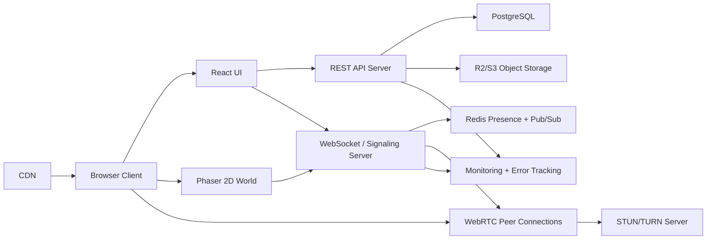
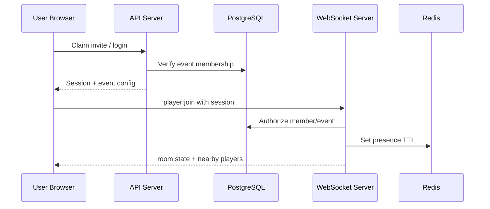
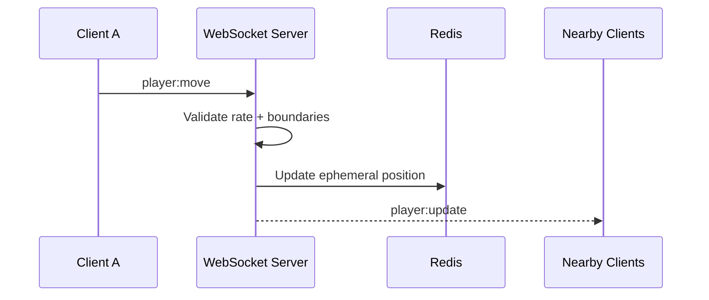
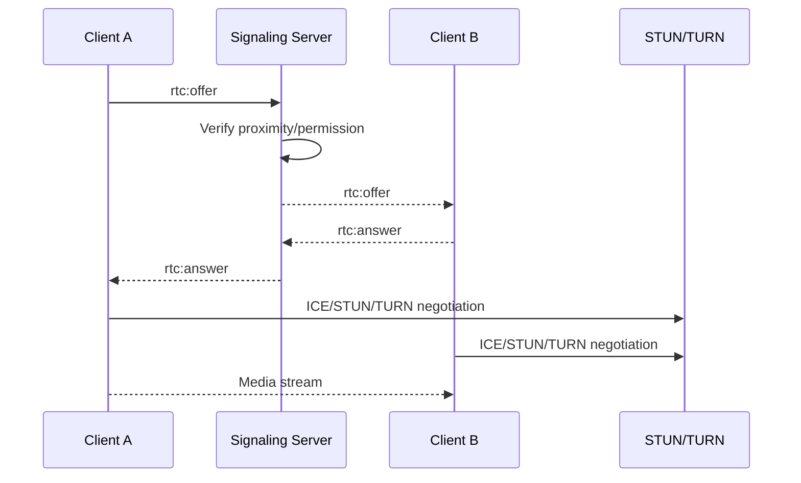

# HackVerse MVP PRD

## 1. Executive Summary

HackVerse is a browser-based virtual campus for hackathons. Participants join as avatars in a 2D world, move through event spaces, encounter teammates and other participants, find mentors, visit sponsor booths, attend main-stage sessions, and enter private team rooms.

The MVP is not a generic virtual office and not a full hackathon management platform. It should validate one core hypothesis:

> Hackathon participants and organizers will find HackVerse more useful and engaging than a collection of disconnected Discord, WhatsApp, Zoom, Google Meet, and submission links.

For the first 10-15 hackathons, the platform should charge no platform fee. Organizers reimburse infrastructure costs only. The product and architecture should therefore prioritize fast setup, reliability during live events, low bandwidth use, low operational cost, and product learning.

## 2. Problem Statement

Remote and hybrid hackathons often feel fragmented. Participants receive links for chat, live sessions, mentor calls, submissions, sponsor resources, announcements, and team coordination. This works operationally but loses the social texture of physical hackathons: seeing activity around you, bumping into people, knowing where mentors are, gathering around a stage, and feeling like everyone is in the same event.

Organizers need a way to make online and hybrid hackathons feel alive without replacing every tool they already use.

## 3. Product Vision

Create the default virtual venue layer for hackathons: a lightweight, playful, reliable 2D campus that makes online participants feel physically present in a shared hackathon environment.

The product should eventually coexist with registration, judging, streaming, chat, and submission systems, but the MVP must prove that spatial presence creates enough value to justify adoption.

## 4. Goals

- Let participants enter an event in under 60 seconds.
- Make the live hackathon feel active through avatars, rooms, proximity, and announcements.
- Enable quick teammate, mentor, sponsor, and stage discovery.
- Give organizers enough controls to run one event safely.
- Measure whether users return and interact meaningfully.
- Keep infrastructure cost low enough for free early pilots.

## 5. Non-Goals

- Full registration platform.
- Full submission or judging platform.
- Payment processing.
- Native mobile apps.
- 3D, VR, or metaverse-style world building.
- Full Discord replacement.
- Full Zoom or Google Meet replacement.
- AI mentor, AI judge, or automated project review.
- Sponsor CRM or recruiting marketplace.
- Complex map editor for non-technical users in the first release.

## 6. Target Users

The first target segment is Indian college and community hackathons with 100-500 concurrent online participants. The architecture should not hard-code India-specific constraints, but it should respect realities such as mixed bandwidth, college Wi-Fi, average laptop hardware, Chrome/Edge usage, WhatsApp-based organizer communication, and cost-sensitive event budgets.

## 7. User Personas

### Participant

A student participant who wants to join quickly, find their team, get help, attend sessions, discover sponsors, and feel part of the event.

Primary needs:
- Enter with minimal login friction.
- Choose an avatar/name.
- Move around the map.
- See who is nearby.
- Talk to teammates and nearby users.
- Join a team room.
- Find available mentors.
- Attend main-stage sessions.
- Receive announcements.
- Access links such as schedule, rules, submissions, and Discord/WhatsApp.

### Mentor

A technical or non-technical mentor helping teams.

Primary needs:
- Join the event as a mentor.
- Set availability: Available, Busy, Do Not Disturb, Offline.
- Be discoverable in the mentor lounge or directory.
- Receive and accept mentor requests.
- See team name, project title, problem category, and requested help.
- Enter a private team room when authorized.
- Avoid being overwhelmed by duplicate requests.

### Organizer/Admin

The event operator responsible for setup, moderation, communication, and reliability.

Primary needs:
- Create/configure one event.
- Add event details, logo, schedule links, and access rules.
- Configure a map from templates.
- Create teams and private rooms.
- Add mentors and sponsors.
- Send announcements.
- See active users and event health.
- Moderate users through mute, kick, ban, and report review.
- Export basic event analytics.

### Sponsor

A company or community sponsor that wants visibility and participant engagement.

Primary needs:
- Have a branded booth.
- Share links, challenges, jobs, APIs, docs, and contact details.
- Interact with participants who visit.
- Host a mini-session or challenge link.
- See basic engagement: visits, clicks, chat starts.

## 8. Core User Journeys

### Participant Journey

1. Participant receives event link.
   - UX: Link opens directly to the event join page with event name, logo, timing, and "Join Campus".
   - Requirement: If the participant has an invite token, pre-fill event membership context.

2. Participant authenticates.
   - UX: Google login only. If the participant opens a magic invite link and does not have a HackVerse account yet, the invite link first sends them through Google account creation/sign-in, then returns them to the event onboarding flow.
   - Requirement: Target entry time under 60 seconds for a new participant who is already signed into Google.

3. Participant enters profile.
   - UX: Name, optional college, optional role, avatar selection.
   - Requirement: Only name and email are required.

4. Participant spawns in campus.
   - UX: Avatar appears at event spawn point with visible nearby participants, mini-map/area labels, bottom control bar, chat, and event links.
   - Requirement: Movement should work with WASD and arrow keys.

5. Participant finds team area.
   - UX: Map labels and sidebar quick links show "My Team Room".
   - Requirement: Team room access is restricted to members, organizers, and accepted mentors.

6. Participant talks to teammates.
   - UX: Team room supports text chat and one-click audio. Video is optional and off by default.
   - Requirement: Users explicitly grant microphone/camera permission.

7. Participant finds mentor.
   - UX: Mentor lounge shows available mentors on map; sidebar mentor list shows status and expertise.
   - Requirement: Participant can submit a mentor request with topic and short description.

8. Mentor accepts request.
   - UX: Participant receives in-app notification and prompt to start private audio or invite mentor to team room.
   - Requirement: The system prevents one mentor from accepting overlapping active requests.

9. Participant visits sponsor booth.
   - UX: Booth displays logo, short description, links, challenge details, and "Talk to sponsor" if representative is online.
   - Requirement: Track booth visit and link clicks.

10. Participant attends main stage.
    - UX: Entering main stage opens embedded YouTube/Meet/Zoom link or external session link in a stage panel.
    - Requirement: MVP should integrate by link/embed rather than building livestreaming.

11. Organizer sends announcement.
    - UX: Announcement appears as toast, notification center item, and optional browser notification.
    - Requirement: Critical announcements can be pinned.

12. Participant submits project externally.
    - UX: Persistent event links include submission link to Devfolio, Devpost, Unstop, Google Form, or custom URL.
    - Requirement: MVP does not implement judging/submission unless a simple external link is configured.

### Organizer Journey

1. Organizer creates event from dashboard.
2. Selects a map template.
3. Adds event links, schedule, rules, submission URL.
4. Imports participants/teams via CSV.
5. Adds mentors and sponsors.
6. Generates invite links.
7. Runs a pre-event test with 10-30 users.
8. Monitors active users and event health during event.
9. Sends announcements.
10. Moderates misuse.
11. Reviews analytics after event.

### Mentor Journey

1. Mentor joins via mentor invite.
2. Sets expertise and availability.
3. Appears in mentor lounge/directory.
4. Receives request.
5. Accepts, rejects, or marks busy.
6. Enters team room or starts private call.
7. Ends session and marks available again.

### Sponsor Journey

1. Sponsor representative joins via sponsor invite.
2. Visits assigned booth.
3. Updates availability.
4. Talks to visitors.
5. Shares resources.
6. Reviews basic engagement after event.

## 9. Product Principles

- Presence over administration.
- Join fast, learn by moving.
- Spatial interaction should feel optional, not forced.
- Audio/video requires consent.
- Reliability beats feature count.
- Reuse existing hackathon tools where they are already strong.
- Build for low bandwidth first.
- Make organizers feel in control.
- Track validation metrics from day one.

## 10. Feature Requirements

### Virtual World

MVP requirements:
- 2D top-down campus.
- Avatar movement with keyboard controls.
- Real-time multiplayer position updates.
- Map boundaries and collision detection.
- Spawn points.
- Labeled areas: Main Stage, Team Area, Mentor Lounge, Sponsor Booths, Chill Zone.
- Interaction zones that trigger panels or prompts.
- Presence indicators.
- Basic mini-map or area directory.

Acceptance criteria:
- A participant can load the map, move smoothly, and see at least 100 other users represented without freezing on an average laptop.
- Collision prevents walking through blocked tiles.
- A reconnecting user returns to the last valid room or default spawn.

### Proximity Interaction

MVP requirements:
- Distance-based nearby detection.
- Nearby user list.
- "Press E" or click-to-interact prompt.
- Text chat scoped to room or direct conversation.
- Proximity audio for opted-in users.
- Optional video for private/team conversations.
- Mute, deafen, block, report.

Interaction model:

```text
Distance > 6 tiles
  No nearby interaction.

Distance <= 6 tiles
  User appears in nearby list.

Distance <= 3 tiles
  Interaction indicator appears.

User clicks Start Audio
  Permission prompt appears if needed.
  WebRTC session starts only after consent.

User moves outside 6 tiles
  Audio fades or disconnects after grace period.
```

Acceptance criteria:
- Audio does not start without user action or prior opt-in.
- Moving away closes proximity connections automatically.
- Users can mute themselves globally.
- Blocked users cannot initiate direct interaction.

### Rooms

Room types:
- Public: anyone in event can enter.
- Team: team members, organizers, and authorized mentors.
- Mentor: mentors and participants requesting help.
- Sponsor: public sponsor area plus optional sponsor-only back area.
- Admin: organizer-only space.

MVP requirements:
- Room membership and access control.
- Room-scoped chat.
- Presence list per room.
- Private team rooms.
- Mentor entry to team room via accepted request or organizer permission.

Acceptance criteria:
- Unauthorized users cannot enter protected rooms through UI or WebSocket event spoofing.
- Room chat messages are visible only to room members.

### Main Stage

MVP requirements:
- Stage area on map.
- Stage panel with session title, schedule, host, and link/embed.
- Organizer announcement support.
- Attendance tracking based on users in stage area.

Out of scope:
- Native livestreaming infrastructure.
- Recording.
- Complex agenda management.

### Mentor Lounge

MVP requirements:
- Mentor profile with name, expertise, status.
- Mentor availability control.
- Participant request form.
- Request queue for mentors.
- Accept/reject flow.
- Basic response time analytics.

Acceptance criteria:
- Participant can request help in under 30 seconds.
- Mentor can accept exactly one active request unless explicitly marked as group mentoring.

### Sponsor Booths

MVP requirements:
- Booth area with logo, short description, resource links, challenge info.
- Representative presence if online.
- "Open resources" and "Talk to sponsor" actions.
- Visit and link-click analytics.

Acceptance criteria:
- Sponsor content can be configured by organizer before event.
- Participants can access sponsor links without leaving the campus context unexpectedly.

### Organizer Dashboard

MVP requirements:
- Create hackathon.
- Configure event name, logo, time zone, start/end.
- Select/upload map JSON from approved templates.
- Configure rooms and spawn points.
- Import participants, teams, mentors via CSV.
- Add sponsors and booths.
- Create announcements.
- View active users and current area counts.
- View basic engagement analytics.
- Moderate users: mute, kick, ban.
- Generate participant, mentor, sponsor, and admin invite links.

Post-MVP:
- Drag-and-drop map editor.
- Advanced analytics dashboards.
- Automated registration approval.
- Judging workflow.
- Sponsor self-serve portal.

## 11. MVP Scope

### In MVP

- Browser-based participant app.
- HackVerse 2D campus.
- Avatar movement and real-time presence.
- Team rooms.
- Proximity detection.
- Text chat.
- Opt-in proximity audio.
- Optional video for private/team calls.
- Mentor lounge and request flow.
- Sponsor booths.
- Main stage links/embed.
- Announcements.
- Minimal organizer dashboard.
- Basic analytics.
- Moderation controls.
- CSV imports.
- Event invite links.
- Reliability, reconnect, health checks.

### Not in MVP

- Native mobile apps.
- Full custom map editor.
- Full submission/judging.
- Payment system.
- Built-in livestreaming.
- Recording.
- AI features.
- Complex social profiles.
- Public event discovery marketplace.

## 12. Out of Scope

The MVP should not compete with Devpost, Devfolio, Unstop, or HackerEarth on registration, submissions, judging, or public hackathon discovery. It should integrate through links and later APIs if validated.

## 13. UX Requirements

### Participant Screens

- Login/join page: event identity, date/time, join button.
- Profile/avatar selection: name, optional college, avatar choice.
- Event lobby: optional pre-spawn loading area for permissions and controls.
- HackVerse campus: main experience with map, avatars, controls, chat, notifications.
- Team room: private space with team presence, chat, audio/video controls, links.
- Mentor interaction: request modal, status updates, accepted session panel.
- Sponsor booth: branded panel with resources and representative availability.
- Stage: embedded or linked session panel.

UX requirements:
- The participant experience should feel game/social-first, not SaaS-first.
- Controls must be visible but not dominate the map.
- Important event links should always be one click away.
- UI must have a low-bandwidth mode: disable video, reduce avatar update rate, and simplify effects.

### Organizer Screens

- Login.
- Event dashboard.
- Event setup.
- Map/room configuration.
- Participants and teams.
- Mentors.
- Sponsors.
- Announcements.
- Analytics.
- Moderation.

UX requirements:
- Organizer dashboard may be conventional and dense.
- During live events, dashboard should prioritize active users, incidents, announcements, and system health.

### Mentor Screens

- Mentor join/profile.
- Availability selector.
- Request queue.
- Active request detail.
- Team room entry prompt.

### Sponsor Screens

- Booth preview.
- Representative status.
- Resource links.
- Basic engagement report.

## 14. Technical Architecture

Recommended stack:

- Frontend: React + TypeScript + Vite.
- Game layer: Phaser.js.
- Styling: Tailwind CSS.
- Backend: FastAPI or Django.
- Real-time: WebSocket server, initially integrated with backend or separate service if needed.
- Database: PostgreSQL.
- Cache/presence: Redis.
- Storage: Cloudflare R2 or S3-compatible storage.
- WebRTC: browser WebRTC with signaling over WebSocket, STUN, and TURN fallback.
- Infrastructure: Docker, managed PostgreSQL, managed Redis, CDN, TURN server.

Recommendation: choose React + TypeScript + Vite + Phaser for fast iteration and clear separation between game rendering and UI panels. Use FastAPI if the team prefers lightweight async WebSocket development; use Django if admin/dashboard speed and built-in auth/admin are more important. For this MVP, Django with Channels is viable, but FastAPI may be simpler for real-time services. Pick one based on team strength, not popularity.



### Why Each Technology

- React: mature UI model for panels, dashboard, forms, notifications, and stateful controls.
- TypeScript: reduces client/server event contract errors.
- Vite: faster MVP iteration than Next.js when server-side rendering is not central.
- Phaser: proven 2D game engine for tile maps, collisions, sprites, and camera handling.
- Tailwind CSS: rapid consistent UI without building a full design system.
- FastAPI: async-friendly APIs and WebSocket support with low framework overhead.
- Django alternative: strong admin/auth if the team wants faster dashboard scaffolding.
- PostgreSQL: reliable relational source of truth for events, users, teams, rooms, sponsors.
- Redis: ephemeral presence, pub/sub, rate limiting, session state, and WebSocket fanout.
- R2/S3: inexpensive storage for logos, map files, avatar assets.
- TURN: required for users behind restrictive college/corporate networks.
- Docker: repeatable deploys and local dev parity.
- CDN: static asset delivery, lower latency, lower backend load.

## 15. Real-Time Architecture

WebSocket responsibilities:
- Authenticate event membership.
- Join/leave event channel.
- Broadcast player position.
- Maintain room membership.
- Publish user status.
- Deliver chat messages.
- Deliver announcements.
- Coordinate WebRTC signaling.
- Send moderation actions.
- Track disconnect/reconnect.

Movement:
- Client sends position deltas at capped rate, e.g. 10-15 updates/second.
- Server validates event, room, collision boundaries if feasible, and rate limits.
- Server broadcasts nearby positions, not entire event state, for larger events.
- Client interpolates remote avatar positions.

Presence:
- Redis stores active connection state with TTL.
- PostgreSQL stores durable event membership and room definitions.
- Presence is ephemeral and should survive brief reconnects.

Scaling approach:
- For 100-500 concurrent users, one or two WebSocket instances plus Redis pub/sub can work.
- For 1,000+ concurrent users, partition by event and room/area.
- Use interest management: clients receive updates only for users in same map/nearby area.

## 16. WebRTC Architecture

WebRTC responsibilities:
- Proximity audio.
- Optional video.
- Private/team conversations.

Signaling:
- WebSocket carries offer, answer, ICE candidates, join/leave media session, mute status.
- Signaling messages are authorized by event and room/proximity rules.

STUN/TURN:
- STUN helps establish direct peer connections.
- TURN relays media when direct connection fails.
- TURN is the largest variable cost and must be monitored.

Connection lifecycle:
1. User grants microphone/camera permission.
2. Client enters audio-enabled state.
3. Client detects eligible nearby users or room call.
4. Client requests media session through WebSocket.
5. Server verifies permissions/proximity.
6. Peers exchange WebRTC signaling.
7. Media connection starts.
8. On move-away, room leave, mute, block, or disconnect, connection is closed.

Preventing excessive connections:
- Cap active proximity audio peers, e.g. 4-6 nearby users.
- Use room-based audio groups for team rooms where needed.
- Do not auto-start video.
- Disable proximity media in high-density areas by default; stage uses broadcast link/embed.
- Add low-bandwidth mode with text-only and no video.

## 17. Map Architecture

Recommended MVP approach:
- Use Tiled to design maps.
- Export map data as JSON.
- Render with Phaser.
- Store map JSON and assets in R2/S3.
- Maintain event-specific configuration for spawn points, rooms, portals, and interaction zones.

Map concepts:
- Tileset: visual ground/walls/objects.
- Collision layer: impassable tiles.
- Spawn points: default, team, mentor, sponsor, admin.
- Portals: move between map areas or rooms.
- Rooms: logical access-controlled zones.
- Interaction zones: sponsor booth, stage panel, mentor desk, help desk.
- Audio zones: proximity rules and media behavior.
- Private zones: team rooms and admin rooms.

Example logical layout:

```text
                MAIN STAGE

        SPONSOR      MENTOR LOUNGE

              +-------------+
              | TEAM AREA   |
              |             |
              +-------------+

     TEAM 1      TEAM 2      TEAM 3

              CHILL ZONE
```

Map JSON should include:

```json
{
  "mapId": "college-campus-v1",
  "tilesetUrl": "...",
  "tiledJsonUrl": "...",
  "spawnPoints": [{ "id": "default", "x": 12, "y": 8 }],
  "rooms": [{ "id": "main_stage", "type": "public", "polygon": [] }],
  "portals": [{ "from": "campus", "to": "team_area", "x": 20, "y": 15 }],
  "interactionZones": [{ "id": "sponsor_acme", "type": "sponsor_booth" }],
  "audioZones": [{ "id": "chill", "mode": "proximity", "radius": 6 }]
}
```

## 18. Database Schema

### users

- id UUID PK
- email CITEXT unique not null
- display_name text not null
- avatar_id text nullable
- college text nullable
- created_at timestamptz
- updated_at timestamptz

Indexes:
- unique(email)

### events

- id UUID PK
- name text not null
- slug text unique not null
- logo_url text nullable
- timezone text not null default "Asia/Kolkata"
- starts_at timestamptz not null
- ends_at timestamptz not null
- status enum draft/live/ended/archived
- map_id UUID nullable
- external_links jsonb not null default '{}'
- created_by UUID FK users(id)
- created_at timestamptz
- updated_at timestamptz

Indexes:
- unique(slug)
- index(status, starts_at)

### event_members

- id UUID PK
- event_id UUID FK events(id)
- user_id UUID FK users(id)
- role enum participant/mentor/sponsor/admin
- status enum invited/active/banned/removed
- invite_token_hash text nullable
- joined_at timestamptz nullable
- created_at timestamptz

Constraints:
- unique(event_id, user_id)

Indexes:
- index(event_id, role)
- index(event_id, status)

### teams

- id UUID PK
- event_id UUID FK events(id)
- name text not null
- project_title text nullable
- room_id UUID nullable
- created_at timestamptz

Constraints:
- unique(event_id, name)

### team_members

- id UUID PK
- team_id UUID FK teams(id)
- event_member_id UUID FK event_members(id)
- created_at timestamptz

Constraints:
- unique(team_id, event_member_id)

### mentor_profiles

- id UUID PK
- event_member_id UUID FK event_members(id) unique
- expertise text[] default '{}'
- bio text nullable
- availability enum available/busy/dnd/offline
- active_request_id UUID nullable
- updated_at timestamptz

Indexes:
- index(availability)

### sponsors

- id UUID PK
- event_id UUID FK events(id)
- name text not null
- logo_url text nullable
- description text nullable
- website_url text nullable
- created_at timestamptz

### sponsor_booths

- id UUID PK
- sponsor_id UUID FK sponsors(id)
- room_id UUID FK rooms(id)
- resource_links jsonb not null default '[]'
- challenge_info text nullable
- contact_event_member_id UUID nullable

### rooms

- id UUID PK
- event_id UUID FK events(id)
- name text not null
- type enum public/team/mentor/sponsor/admin
- access_policy jsonb not null default '{}'
- map_zone_id text nullable
- max_capacity int nullable
- created_at timestamptz

Indexes:
- index(event_id, type)

### maps

- id UUID PK
- name text not null
- map_json_url text not null
- tileset_url text nullable
- version int not null default 1
- created_by UUID FK users(id)
- created_at timestamptz

### announcements

- id UUID PK
- event_id UUID FK events(id)
- created_by UUID FK users(id)
- title text not null
- body text not null
- priority enum normal/high/critical
- target enum all/participants/mentors/sponsors/team/room
- target_id UUID nullable
- created_at timestamptz

Indexes:
- index(event_id, created_at)

### mentor_requests

- id UUID PK
- event_id UUID FK events(id)
- team_id UUID FK teams(id) nullable
- requester_member_id UUID FK event_members(id)
- mentor_member_id UUID FK event_members(id) nullable
- topic text not null
- description text nullable
- status enum open/accepted/rejected/cancelled/completed/expired
- created_at timestamptz
- accepted_at timestamptz nullable
- completed_at timestamptz nullable

Indexes:
- index(event_id, status, created_at)
- index(mentor_member_id, status)

### interaction_events

- id UUID PK
- event_id UUID FK events(id)
- actor_member_id UUID FK event_members(id) nullable
- type text not null
- target_type text nullable
- target_id UUID nullable
- metadata jsonb not null default '{}'
- created_at timestamptz

Indexes:
- index(event_id, type, created_at)
- index(event_id, created_at)

Note: real-time coordinates, active socket IDs, and ephemeral room presence should live in Redis, not PostgreSQL.

## 19. API Specification

### Authentication

| Method | Path | Purpose | Auth | Request | Response | Errors |
|---|---|---|---|---|---|---|
| POST | /auth/google | Google login exchange | Public | idToken | session | 401 |
| GET | /auth/google/start | Start Google OAuth | Public | inviteToken? | redirect | 400 |
| GET | /auth/google/callback | Complete Google OAuth | Public | code, state | session redirect | 401 |
| GET | /auth/invite/{inviteToken} | Resolve invite and start auth if needed | Public/session | none | redirect/event preview | 400, 410 |
| POST | /auth/invite/claim | Claim event invite after Google auth | Session | inviteToken | session, eventMember | 400, 410 |
| POST | /auth/logout | Logout | Session | none | ok | 401 |

Recommended MVP authentication:
- Google login is the only account creation/sign-in method.
- Event invite links do not create email-only accounts; they preserve invite context, require Google authentication, then bind the verified Google user to the event role/team.
- No email/password and no standalone email magic-link authentication in MVP.
- Invite tokens assign event access after login and may optionally enforce that the Google account email matches the invited email or allowed domain.

### Events

| Method | Path | Purpose | Auth |
|---|---|---|---|
| POST | /events | Create event | Admin |
| GET | /events/{eventId} | Get event config | Member |
| PATCH | /events/{eventId} | Update event | Admin |
| POST | /events/{eventId}/publish | Publish event | Admin |
| GET | /events/{eventId}/links | Get configured external links | Member |

### Participants and Teams

| Method | Path | Purpose | Auth |
|---|---|---|---|
| POST | /events/{eventId}/members/import | CSV import | Admin |
| GET | /events/{eventId}/members | List members | Admin |
| PATCH | /events/{eventId}/members/{memberId} | Update role/status | Admin |
| POST | /events/{eventId}/teams/import | CSV import teams | Admin |
| GET | /events/{eventId}/teams | List teams | Admin/member |
| GET | /events/{eventId}/teams/me | Get my team | Participant |
| PATCH | /events/{eventId}/teams/{teamId} | Update team | Admin |

### Rooms

| Method | Path | Purpose | Auth |
|---|---|---|---|
| GET | /events/{eventId}/rooms | List rooms | Member |
| POST | /events/{eventId}/rooms | Create room | Admin |
| PATCH | /events/{eventId}/rooms/{roomId} | Update room | Admin |
| POST | /events/{eventId}/rooms/{roomId}/authorize | Grant temporary access | Admin/mentor flow |

### Mentors

| Method | Path | Purpose | Auth |
|---|---|---|---|
| GET | /events/{eventId}/mentors | List mentors/status | Member |
| PATCH | /events/{eventId}/mentor-profile | Update own status | Mentor |
| POST | /events/{eventId}/mentor-requests | Create request | Participant |
| GET | /events/{eventId}/mentor-requests | List requests | Mentor/Admin |
| POST | /events/{eventId}/mentor-requests/{id}/accept | Accept request | Mentor |
| POST | /events/{eventId}/mentor-requests/{id}/complete | Complete request | Mentor/Participant |

### Sponsors

| Method | Path | Purpose | Auth |
|---|---|---|---|
| GET | /events/{eventId}/sponsors | List sponsors | Member |
| POST | /events/{eventId}/sponsors | Create sponsor | Admin |
| PATCH | /events/{eventId}/sponsors/{id} | Update sponsor | Admin |
| POST | /events/{eventId}/sponsor-booths/{id}/visit | Track booth visit | Member |

### Announcements

| Method | Path | Purpose | Auth |
|---|---|---|---|
| GET | /events/{eventId}/announcements | List announcements | Member |
| POST | /events/{eventId}/announcements | Create announcement | Admin |

### Analytics

| Method | Path | Purpose | Auth |
|---|---|---|---|
| GET | /events/{eventId}/analytics/summary | Summary metrics | Admin |
| GET | /events/{eventId}/analytics/health | Technical health | Admin |
| GET | /events/{eventId}/analytics/export | CSV export | Admin |

## 20. WebSocket Events

Client to server:

| Event | Purpose | Payload |
|---|---|---|
| player:join | Join event/map | eventId, roomId? |
| player:move | Send position | x, y, direction, seq |
| player:status | Update status | available/busy/dnd/mentoring |
| room:enter | Enter room/zone | roomId |
| room:leave | Leave room/zone | roomId |
| chat:message | Send chat | scope, targetId, body |
| mentor:request | Create quick request | topic, description, teamId |
| mentor:accept | Accept request | requestId |
| rtc:offer | WebRTC offer | sessionId, targetMemberId, sdp |
| rtc:answer | WebRTC answer | sessionId, targetMemberId, sdp |
| rtc:ice | ICE candidate | sessionId, targetMemberId, candidate |
| moderation:report | Report user | targetMemberId, reason |

Server to client:

| Event | Purpose | Payload |
|---|---|---|
| player:joined | User joined | member, position |
| player:left | User left | memberId |
| player:update | Nearby player update | memberId, x, y, status |
| nearby:update | Nearby list changed | members |
| room:entered | Room state | roomId, members |
| room:denied | Access denied | roomId, reason |
| chat:message | Deliver chat | message |
| mentor:request:new | Notify mentor | request |
| mentor:request:accepted | Notify requester | request |
| announcement:new | Announcement | title, body, priority |
| rtc:offer | Forward offer | sessionId, fromMemberId, sdp |
| rtc:answer | Forward answer | sessionId, fromMemberId, sdp |
| rtc:ice | Forward ICE | sessionId, fromMemberId, candidate |
| moderation:action | Mute/kick/ban | action, reason |
| system:error | Error | code, message |

## 21. Security

MVP security requirements:
- Session authentication for REST and WebSocket.
- Signed event invite tokens stored as hashes.
- Role-based authorization for admin, mentor, sponsor, participant.
- Event isolation in all queries.
- Room access checks server-side.
- WebSocket message validation and rate limiting.
- Chat rate limiting and abuse detection basics.
- Input validation and output escaping.
- XSS protection for chat, sponsor descriptions, links.
- CSRF protection if cookie-based sessions are used.
- File upload validation for logos/maps.
- Moderation: mute, kick, ban, report, block.
- Secrets stored in environment/secret manager, never in repo.
- Audit log for admin moderation actions.

College-student safety considerations:
- Minimize public profile fields.
- Make report/block visible.
- Allow organizers to remove disruptive users quickly.
- Do not expose participant emails to other participants.

## 22. Privacy

Required data:
- Email.
- Display name.
- Event membership.
- Role.

Optional data:
- College.
- Team/project title.
- Mentor expertise.
- Avatar.

Analytics data:
- Join/leave timestamps.
- Room visits.
- Stage attendance.
- Sponsor booth visits/link clicks.
- Mentor request lifecycle.
- Chat count metadata.
- WebRTC connection success/failure metadata.

Temporary real-time data:
- Current position.
- Nearby users.
- Socket connection ID.
- Active media sessions.

Retention:
- Chat: 30 days by default for moderation/debugging; configurable per event.
- Presence coordinates: ephemeral, TTL in Redis, not retained beyond aggregate analytics.
- Analytics: 12 months for product validation unless deleted by organizer request.
- Event data: retain until organizer deletion or 12 months after event for pilots.
- Recordings: excluded from MVP.

Privacy recommendation:
- Do not record audio/video in MVP.
- Do not collect phone numbers unless organizer imports them for external communication.
- Do not show analytics at individual-user granularity to sponsors.

## 23. Reliability

Reliability requirements:
- Health checks for API, WebSocket, Redis, PostgreSQL, TURN.
- Structured logs with eventId and request/session IDs.
- Error tracking for frontend and backend.
- Metrics: CPU, memory, WebSocket connections, Redis ops, DB latency, TURN bandwidth.
- WebSocket reconnect with exponential backoff.
- Graceful fallback to text chat if WebRTC fails.
- Low-bandwidth mode.
- Database automated backups.
- Deployment rollback.
- Pre-event load test and rehearsal.
- Status banner for degraded mode.

Graceful degradation:
- If video fails, keep audio.
- If audio fails, keep chat.
- If map asset fails, show lobby with event links and chat.
- If WebSocket disconnects, keep static event links and retry.

## 24. Analytics

Product validation metrics:
- Registered members.
- Unique campus visitors.
- Peak concurrent users.
- Average session duration.
- Returning participants.
- Conversations started.
- Mentor requests created/accepted/completed.
- Average mentor response time.
- Team room visits.
- Sponsor booth visits and clicks.
- Main stage attendance.
- Chat activity.

Technical health metrics:
- WebSocket disconnect rate.
- WebSocket reconnect success rate.
- WebRTC setup success rate.
- TURN relay percentage.
- Average latency.
- Client FPS sample or performance beacon.
- Error/crash rate.

The MVP should avoid heavy BI tooling. Store interaction events and generate simple summaries.

## 25. Success Metrics

Adoption:
- 70% of registered participants enter HackVerse at least once.
- 50% of participants return after first visit during the same event.
- 40% of active users join a team room.

Engagement:
- Average active session duration of 25+ minutes during live event windows.
- 3+ meaningful interactions per active participant.
- 25% of participants interact outside their team.

Mentoring:
- 60% of mentor requests receive a response.
- Median mentor response time under 10 minutes during mentor availability windows.
- 70% of accepted mentor requests are completed.

Organizer:
- Event setup completed in under 2 hours after data is available.
- Organizer satisfaction 8/10+ after event.
- 60% of organizers say they would voluntarily use the platform again.

Product validation:
- After 10 pilot events, at least 5 organizers should request reuse without being pushed.
- At least 3 events should use the platform as a central live venue, not just a novelty link.

## 26. Infrastructure & Cost Model

Costs vary heavily by region/provider and TURN usage. These are planning estimates, not quotes.

### 100 Concurrent Users

- API/WebSocket: 1 small VM/container.
- PostgreSQL: small managed instance.
- Redis: small managed instance.
- TURN: small VM; bandwidth depends on media failures.
- Storage/CDN: minimal.
- Monitoring: free/low tier.
- Estimated event cost: low tens of USD for a 24-48 hour event if TURN usage is controlled.

### 500 Concurrent Users

- API: 1-2 instances.
- WebSocket: 2 instances behind load balancer.
- PostgreSQL: small/medium managed instance.
- Redis: managed instance with enough memory for presence.
- TURN: dedicated VM(s), monitor relay bandwidth.
- CDN for assets.
- Estimated event cost: tens to low hundreds of USD depending on video/TURN usage.

### 1,000 Concurrent Users

- API: 2+ instances.
- WebSocket: 3+ instances partitioned by event/area.
- PostgreSQL: medium managed instance with connection pooling.
- Redis: managed Redis with pub/sub headroom.
- TURN: multiple relays or managed TURN with bandwidth budget.
- Observability: paid tier likely.
- Estimated event cost: low hundreds of USD, mostly sensitive to media relay bandwidth.

Primary bottlenecks:
- WebSocket fanout.
- Browser rendering many avatars.
- TURN bandwidth.
- Redis pub/sub throughput.
- Database connection count.
- Client CPU on average laptops.
- College Wi-Fi packet loss.

Cost controls:
- Default video off.
- Cap proximity audio peers.
- Use external livestream links.
- Interest-manage movement updates.
- Cache static assets through CDN.
- Use event-specific infrastructure sizing.

## 27. Competitive Analysis

Gather solves virtual office and spatial meeting use cases with avatar movement, spatial audio/video, desks, and productivity features. Its official materials position it around virtual offices and natural team interactions, including spatial audio/video and office productivity workflows. It does not primarily solve hackathon-specific flows such as team-room assignment, mentor requests, sponsor booths, and organizer validation analytics. Source: [Gather feature overview](https://support.gather.town/articles/3950877146-overview-of-gather-1-0-features).

WorkAdventure solves open-source customizable 2D collaborative worlds and virtual offices. It is strong for self-hosted spatial environments, and its project describes customizable collaborative virtual worlds. It is not a hackathon-specific operating layer by default. Source: [WorkAdventure GitHub](https://github.com/workadventure/workadventure) and [WorkAdventure site](https://workadventu.re/).

Devpost solves hackathon operations: registration, submissions, communication, judging, project galleries, and winner workflows. It is not trying to create a live spatial campus where participants move around and encounter each other. Source: [Devpost platform features](https://info.devpost.com/blog/key-hackathon-platform-features).

Devfolio solves hackathon discovery, participation, and organizing, especially in the Indian hackathon ecosystem. It supports hackathon modes and participation workflows. It does not primarily recreate the live physical venue experience. Source: [Devfolio guide](https://guide.devfolio.co/docs/guide/welcome-to-devfolio) and [Devfolio hackathon modes](https://guide.devfolio.co/docs/guide/participating-in-hackathons/hackathon-modes).

Unstop and HackerEarth are stronger around challenge hosting, talent, assessments, and hackathon management. They are useful for organizer administration and discovery, but not differentiated on embodied live presence.

VaultMeet and similar virtual event tools focus on meetings/events, but the MVP should differentiate by being purpose-built for hackathon patterns: teams, mentor discovery, sponsor challenges, stage, and late-night social presence.

Differentiation thesis:
- Not another generic virtual office.
- Not another registration/submission platform.
- A hackathon-specific live venue layer that plugs into existing tools.

## 28. India-First Considerations

- Desktop-first, Chrome/Edge-first.
- Must run acceptably on average student laptops.
- Low-bandwidth mode is mandatory.
- Video off by default.
- External WhatsApp/Discord links should be easy to access.
- Time zone defaults to Asia/Kolkata but supports any IANA time zone.
- 24/36/48-hour events need stable reconnect and session longevity.
- College Wi-Fi may block peer connections; TURN fallback matters.
- Organizers are cost-sensitive; provide clear infra estimate before event.
- CSV import matters because teams often exist in spreadsheets.
- Do not build UPI/payments until monetization is relevant.

## 29. Risks & Mitigations

| Risk | Type | Impact | Mitigation |
|---|---|---|---|
| Participants treat it as novelty and return to Discord | Product | High | Make team room, mentor flow, and stage links genuinely useful |
| WebRTC fails on college networks | Technical | High | TURN fallback, text fallback, pre-event network test |
| Too many avatars degrade browser performance | Technical | High | Interest management, avatar caps, low-detail mode |
| Organizer setup takes too long | Product | Medium | Map templates, CSV import, onboarding checklist |
| Abuse in public spaces | Safety | High | Report/block/mute/kick/ban in MVP |
| TURN costs spike | Business | Medium | Video off, audio caps, monitor relay bandwidth |
| Competing tools copy surface features | Strategic | Medium | Differentiate through hackathon-specific workflows and data |
| Reliability failure during live event | Product | High | Load test, rehearsal, rollback, degradation paths |

## 30. Development Roadmap

### Milestone 1: Project Foundation

Objective: Establish deployable application skeleton.

Features:
- React/Vite/TypeScript app.
- Backend service.
- PostgreSQL schema migrations.
- Session auth.
- Docker dev setup.

Acceptance criteria:
- Developer can run full stack locally.
- User can log in and fetch event config.

Testing:
- Unit tests for auth/session.
- Smoke test deployment.

### Milestone 2: Map + Avatar Movement

Objective: Render campus and local avatar movement.

Features:
- Phaser map rendering.
- Tiled map loading.
- Avatar sprites.
- Keyboard movement.
- Collision.

Acceptance criteria:
- User can move around map smoothly.
- Collision works on blocked tiles.

Testing:
- Manual browser test.
- Asset load failure test.

### Milestone 3: Real-Time Multiplayer

Objective: Show other participants.

Features:
- WebSocket connect/auth.
- Join/leave event.
- Position broadcast.
- Presence TTL in Redis.
- Reconnect handling.

Acceptance criteria:
- 50 test clients can move and see each other.

Testing:
- WebSocket load test.
- Reconnect test.

### Milestone 4: Rooms + Presence

Objective: Add spatial structure and permissions.

Features:
- Public/team/admin rooms.
- Room enter/leave.
- Room access control.
- Room chat.
- Team import.

Acceptance criteria:
- Team members can enter their room.
- Non-members are denied.

Testing:
- Permission tests.
- WebSocket spoofing tests.

### Milestone 5: Audio/Video

Objective: Enable live conversation.

Features:
- WebRTC signaling.
- STUN/TURN config.
- Proximity audio.
- Team room audio.
- Optional video.
- Mute/deafen.

Acceptance criteria:
- Two users can start audio after consent.
- Connection closes when users move away.

Testing:
- Browser compatibility test.
- TURN fallback test.

### Milestone 6: Organizer Dashboard

Objective: Let organizers configure and run an event.

Features:
- Event CRUD.
- CSV import.
- Map selection.
- Room/team/mentor/sponsor setup.
- Invite links.

Acceptance criteria:
- Organizer can configure a pilot event without database access.

Testing:
- Setup walkthrough.
- CSV validation tests.

### Milestone 7: Mentor + Sponsor Functionality

Objective: Add hackathon-specific value.

Features:
- Mentor profiles/status.
- Mentor request queue.
- Sponsor booth panels.
- Sponsor link tracking.

Acceptance criteria:
- Participant can request mentor and complete session.
- Participant can visit booth and open links.

Testing:
- End-to-end mentor flow.
- Analytics event validation.

### Milestone 8: Announcements + Analytics

Objective: Support live operations and validation.

Features:
- Announcement creation/delivery.
- Notification center.
- Analytics summary.
- Technical health view.

Acceptance criteria:
- Admin announcement reaches active users in under 3 seconds.
- Organizer can see peak concurrency and mentor metrics.

Testing:
- WebSocket delivery test.
- Analytics aggregation test.

### Milestone 9: Load Testing + Reliability

Objective: Prepare for first real hackathon.

Features:
- Synthetic clients.
- Health checks.
- Monitoring dashboard.
- Error tracking.
- Backup/rollback process.

Acceptance criteria:
- 100 concurrent-user load test passes for 1 hour.
- Reconnect works after WebSocket restart.

Testing:
- Load, soak, failure injection.

### Milestone 10: First Real Hackathon

Objective: Validate with live users.

Features:
- Event support playbook.
- Post-event survey.
- Analytics report.

Acceptance criteria:
- Event runs with no critical outage.
- Organizer and participant feedback collected.

## 31. Testing Strategy

- Unit tests: auth, permissions, event membership, room access, API validation.
- Integration tests: REST + database, WebSocket auth, chat, mentor requests.
- End-to-end tests: join event, move, enter room, send chat, receive announcement.
- Load tests: 100, then 500 simulated WebSocket users.
- WebRTC tests: Chrome/Edge, NAT/TURN fallback, device permission denial.
- Security tests: XSS in chat/sponsor fields, invite token misuse, room spoofing.
- Pre-event rehearsal: organizer, mentors, sponsor reps, 10-30 test participants.
- Post-event incident review after every pilot.

## 32. Launch Strategy

### Alpha: 10-30 Users

Goal:
- Validate movement, presence, rooms, and audio basics.

Measure:
- Join success rate.
- Client errors.
- Confusion points.
- Audio setup success.

### Beta: 50-100 Users

Goal:
- Validate basic event operations.

Measure:
- Peak concurrency.
- Movement smoothness.
- Mentor request flow.
- Organizer setup effort.

### First Real Event: 100-300 Participants

Goal:
- Determine whether the campus becomes central to the event.

Measure:
- Adoption, returns, session duration, mentor interactions, sponsor visits.
- Organizer satisfaction.
- Support incidents.

### Events 2-5

Goal:
- Fix reliability and UX issues.

Measure:
- Repeat usage.
- Lower setup time.
- Reduced failure rate.

### Events 6-15

Goal:
- Validate whether organizers voluntarily reuse.

Measure:
- Reuse requests.
- Willingness to reimburse infra.
- Participant preference versus Discord/Meet only.

## 33. Post-MVP Roadmap

P1 after validation:
- Better map template library.
- Improved mentor matching.
- Sponsor self-serve updates.
- Event schedule module.
- Browser notifications.
- More robust analytics export.
- Basic submission status linkback.

P2:
- Drag-and-drop map editor.
- Devfolio/Devpost/Unstop API integrations if available.
- Advanced moderation queue.
- Team formation support.
- Persistent community spaces.
- Mobile read-only mode.

P3:
- Native mobile apps.
- Built-in judging.
- Payments.
- Recruiting/sponsor CRM.
- AI mentor.
- AI judging.
- 3D world.
- VR support.

## 34. Open Questions

- Will organizers import participants before the event, or should anyone with a link enter?
- Should team assignment happen outside the platform for MVP?
- Should proximity audio auto-connect after one global opt-in, or require explicit per-conversation start?
- Which external submission platforms are most common among first 10 pilot events?
- What is the maximum acceptable infrastructure reimbursement for small college hackathons?
- How much sponsor engagement is required for organizers to see value?
- Should chat be retained for moderation or deleted immediately after event?
- Is Google login acceptable for all target colleges, and should invites require exact email matching?

## 35. Final MVP Definition

HackVerse MVP is a desktop-first hackathon campus where participants join quickly, move as avatars through a 2D event map, enter team rooms, discover mentors, visit sponsor booths, attend stage sessions through external links, receive announcements, and generate enough engagement and reliability data for organizers to decide whether they would use it again.

## Feature Prioritization

| Feature | Priority | Reason | MVP? |
|---|---|---|---|
| Event invite link | P0 | Enables fast joining | Yes |
| Google login via invite flow | P0 | Low-friction, safer authentication | Yes |
| Avatar selection | P1 | Identity and presence | Yes |
| 2D map | P0 | Core experience | Yes |
| Avatar movement | P0 | Core experience | Yes |
| Real-time presence | P0 | Core experience | Yes |
| Collision/boundaries | P0 | Makes world coherent | Yes |
| Proximity detection | P0 | Core differentiator | Yes |
| Text chat | P0 | Fallback and basic communication | Yes |
| Proximity audio | P0 | Physical-presence feel | Yes |
| Optional video | P1 | Useful for deeper collaboration | Yes, limited |
| Team rooms | P0 | Hackathon collaboration | Yes |
| Mentor lounge | P0 | Hackathon-specific value | Yes |
| Mentor request queue | P0 | Makes mentors discoverable/actionable | Yes |
| Sponsor booths | P1 | Sponsor value and event realism | Yes |
| Main stage link/embed | P1 | Common hackathon need | Yes |
| Announcements | P0 | Live event operations | Yes |
| Organizer dashboard | P0 | Required to run event | Yes |
| CSV imports | P0 | Fast setup | Yes |
| Basic analytics | P0 | Product validation | Yes |
| Moderation | P0 | Safety | Yes |
| Full map editor | P2 | Useful but not required | No |
| Submissions/judging | P3 | Already solved by other tools | No |
| Payments | P3 | No monetization initially | No |
| AI mentor | P3 | Not core validation | No |
| Native mobile apps | P3 | Slows MVP | No |

## User Stories

### Participant

As a participant, I want to join the campus from an event link so that I can enter the hackathon quickly.

Acceptance criteria:
- Link opens correct event.
- User can authenticate and spawn in under 60 seconds.
- Expired or invalid links show clear error.

Priority: P0

Edge cases:
- User already has an account.
- User joins after event ended.
- Invite token already used.

As a participant, I want to see nearby participants so that I can discover people around me.

Acceptance criteria:
- Nearby list updates as users move.
- Users outside range disappear.
- Blocked users are excluded from interaction prompts.

Priority: P0

Edge cases:
- High-density area.
- Reconnecting user.

As a participant, I want to enter my team room so that I can collaborate privately.

Acceptance criteria:
- Team room appears in quick links.
- Only authorized users can enter.
- Room has chat and media controls.

Priority: P0

Edge cases:
- User has no team.
- Mentor needs temporary access.

As a participant, I want to request mentor help so that my team can unblock quickly.

Acceptance criteria:
- Request includes topic and description.
- Available mentors are notified.
- User receives accepted/rejected notification.

Priority: P0

Edge cases:
- No mentors available.
- Mentor accepts then disconnects.

As a participant, I want to visit sponsor booths so that I can learn about challenges and resources.

Acceptance criteria:
- Booth panel opens in interaction zone.
- Links open correctly.
- Visit is tracked.

Priority: P1

Edge cases:
- Sponsor rep offline.
- Broken external link.

### Mentor

As a mentor, I want to set my availability so that participants know whether they can request help.

Acceptance criteria:
- Availability updates in mentor directory and map.
- Busy mentors do not receive new request alerts by default.

Priority: P0

Edge cases:
- Mentor forgets to mark busy.
- Mentor disconnects mid-session.

As a mentor, I want to see request context so that I can decide whether I can help.

Acceptance criteria:
- Request shows team, topic, description, time waiting.
- Mentor can accept/reject.

Priority: P0

Edge cases:
- Two mentors accept simultaneously.
- Team has no project title.

### Organizer

As an organizer, I want to configure an event so that participants can join a branded campus.

Acceptance criteria:
- Event has name, logo, schedule links, start/end, map.
- Organizer can generate invite links.

Priority: P0

Edge cases:
- Missing map.
- Invalid event time.

As an organizer, I want to import participants and teams so that setup is fast.

Acceptance criteria:
- CSV validates required columns.
- Errors are shown before import commit.
- Team rooms are created or linked.

Priority: P0

Edge cases:
- Duplicate emails.
- User belongs to multiple teams.

As an organizer, I want to send announcements so that all participants receive urgent updates.

Acceptance criteria:
- Announcement appears to active users within 3 seconds.
- Announcement is stored for later viewers.
- Critical announcements can be pinned.

Priority: P0

Edge cases:
- User is offline.
- WebSocket reconnects after announcement.

As an organizer, I want to moderate users so that the event remains safe.

Acceptance criteria:
- Admin can mute, kick, ban.
- Banned user cannot reconnect to event.
- Action is logged.

Priority: P0

Edge cases:
- User has multiple tabs.
- Admin accidentally kicks wrong user.

### Sponsor

As a sponsor, I want a branded booth so that participants can discover my company/challenge.

Acceptance criteria:
- Booth shows logo, description, resources, challenge info.
- Visits and link clicks are tracked.

Priority: P1

Edge cases:
- Assets fail to load.
- Sponsor link is malformed.

As a sponsor representative, I want to talk to booth visitors so that I can answer questions.

Acceptance criteria:
- Representative appears online at booth.
- Participant can start interaction with consent.

Priority: P1

Edge cases:
- Multiple visitors at once.
- Representative is busy.

## Critical Product Questions

1. Why would a participant use this instead of Discord?
   - Because it makes the event spatial and discoverable: participants can see where people, mentors, teams, sponsors, and sessions are instead of searching channels and links.

2. Why would an organizer use this instead of Google Meet + Discord?
   - Because it gives organizers a central live venue with stage, mentor, team, sponsor, announcement, and activity visibility without replacing their existing tools.

3. What is the single most valuable feature?
   - Proximity-based virtual presence tied to hackathon-specific spaces.

4. What is the wow moment?
   - Joining and immediately seeing the campus alive with moving participants, then walking into a team room or mentor lounge and starting a real conversation.

5. What creates network effects?
   - The campus becomes more useful as more participants, mentors, sponsors, and organizers are present simultaneously.

6. What makes participants return?
   - Their team room, mentor availability, stage sessions, announcements, and spontaneous interactions.

7. What makes organizers use it again?
   - Higher engagement, easier mentor discovery, sponsor visibility, and evidence that participants felt the event was more alive.

8. What is difficult for competitors to copy?
   - The combination of hackathon-specific live workflows, organizer playbooks, analytics, and event templates built from real pilot data.

9. What is the biggest technical risk?
   - WebRTC reliability and cost under real college network conditions.

10. What is the biggest product risk?
    - Participants may prefer familiar tools and treat the campus as a novelty.

11. What could cause the product to fail?
    - Poor reliability during live events, slow onboarding, confusing map UX, or no clear reason to return after first visit.

12. What assumptions need validation during the first 10 events?
    - Participants enjoy spatial presence.
    - Mentors respond faster when visible.
    - Sponsors get meaningful engagement.
    - Organizers can set up without heavy support.
    - Infrastructure costs are acceptable.
    - The platform complements rather than fights existing tools.

## Data Flows

### User Joins Event



### User Moves



### User Starts Audio



## Desktop, Tablet, and Mobile

MVP recommendation: desktop-first.

Why:
- Hackathon participants usually code on laptops/desktops.
- Keyboard movement and multitasking work better on desktop.
- WebRTC, map rendering, and coding resources are harder on mobile.
- Mobile support would slow the MVP and increase QA complexity.

MVP should support tablet/mobile only as a degraded view:
- Read announcements.
- Open event links.
- View schedule/stage link.
- Maybe chat.

Full mobile movement and media are post-MVP.

## Integration Strategy

MVP integrations:
- External links to Discord, WhatsApp, Google Meet, Zoom, YouTube, Devfolio, Devpost, Unstop, Google Forms, GitHub.
- Optional YouTube embed for stage if event uses it.
- GitHub link fields for projects/teams, not full OAuth integration.

Post-MVP:
- Devfolio/Devpost/Unstop sync if APIs and partnerships make sense.
- Google Calendar schedule import.
- Discord bot for announcements.
- GitHub project submission sync.

MVP principle:
- Link out where other tools are already strong.
- Build native only where spatial presence changes the experience.

## MVP in One Sentence

HackVerse is a desktop-first 2D campus for hackathons where participants move as avatars, meet nearby people, collaborate in private team rooms, find mentors, visit sponsor booths, attend stage sessions through existing links, and give organizers enough control and analytics to validate whether the shared virtual venue is worth using again.
